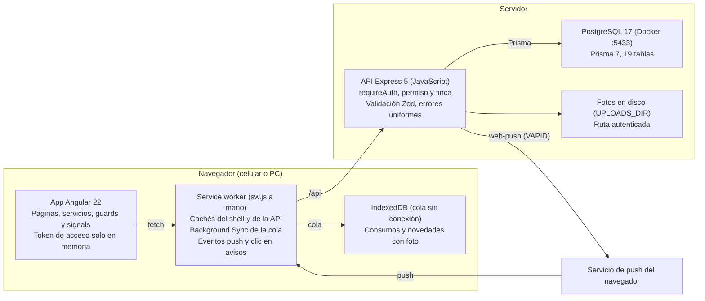
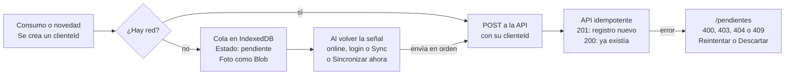

# CuidAgro: documento de contexto del proyecto

Actualizado el 24 de noviembre de 2026. Copia local del documento de contexto. Los diagramas están en Mermaid.

## Resumen

CuidAgro es una PWA para monitorear el cuidado y bienestar de animales de granja (vacunos y lotes de ovíparos): registro de animales, alimentación, inventario, salud, medicamentos, reportes, uso sin conexión y notificaciones. Es el proyecto final de la Electiva III PWA, grupo 3 (Sebastián Arias Giraldo, Gustavo Andrés Barrera Arcos y Juan David López Castro).

Estado al 24 de noviembre de 2026: las fases 1 a 8 están terminadas y verificadas con QA; falta la Fase 9 (pruebas finales y despliegue). Las 7 historias de usuario oficiales del Excel del curso están cumplidas de punta a punta.

| Dato | Valor |
| --- | --- |
| Repositorio | `Documents/PWA/proyecto final PWA`, rama `desarrollo` (`main` solo tiene el commit inicial) |
| Frontend | Angular 22 + TypeScript, sin zone.js, signals |
| Backend | Node + Express 5 en JavaScript, Prisma 7.10.1 |
| Base de datos | PostgreSQL 17 en Docker, puerto 5433 |
| Pruebas | 518 de backend (Vitest + Supertest), 47 de frontend, E2E con Playwright |
| Contexto por fase | `docs/fases/fase-NN-*.md` y su índice `docs/fases/README.md` |

## Lo pedido inicialmente: HU oficiales del Excel

Las 7 historias del Excel del curso (grupo 3) son lo que se evalúa, y todas están implementadas, probadas por API y recorridas en navegador por la QA. El resto del sistema se construyó sin romperlas.

| HU oficial (Excel) | Cómo se cumple | Pantalla | API | Fase |
| --- | --- | --- | --- | --- |
| Registrar vacuno: nombre, sexo, raza, edad, peso, fecha de llegada, propósito | Formulario con los 7 campos; edad numérica en meses; propósito Alimentación, Producción lechera o Engorde | `/vacunos` | `POST /api/vacunos` | 3 |
| Registrar lote de ovíparo: rango de edad, cantidad, propósito | Rango de edad mínima y máxima en semanas, cantidad de aves, propósito Producción o Alimentación | `/lotes` | `POST /api/lotes` | 3 |
| Registrar alimento: nombre, tipo, cantidad | Inventario por finca con tipo (concentrado, forraje, grano, suplemento, sal mineral, otro) y stock en gramos, mostrado en kg | `/alimentos` | `POST /api/alimentos` | 4 |
| Alimento consumido ovíparo: gramos, lote, fecha | Consumo de lote con gramos, lote, jornada y fecha; descuenta del inventario. Funciona sin conexión | `/consumos` | `POST /api/consumos/lotes` | 4 y 8 |
| Alimento consumido vacuno: gramos, animal, jornada, fecha | Consumo de vacuno con los 4 campos; descuenta del inventario. Funciona sin conexión | `/consumos` | `POST /api/consumos/vacunos` | 4 y 8 |
| Registrar novedades: descripción, foto, GPS, lote | Novedad con descripción, foto de la cámara (recodificada en el navegador), ubicación GPS y lote; también admite un vacuno. Funciona sin conexión | `/novedades` | `POST /api/novedades` (multipart) | 5 y 8 |
| Reportes: consumo por día y mes, por animal o lote | Reporte agrupado por día o mes, por vacuno, lote o todos, con gráfico, tabla, CSV e impresión | `/reportes` | `GET /api/reportes/consumos` | 7 |

Diferencias con el Excel, decididas con el usuario:

- **Jornada:** el Excel dice día o tarde; se usa mañana, tarde y noche (decidido el 18 de noviembre de 2026). También se pide la jornada en el consumo de ovíparos.
- **Novedades:** el Excel las liga a un lote; el prompt ampliado permite lote o vacuno, y se aceptan ambos.
- **Unidades:** todo se guarda en gramos enteros y se muestra en kg cuando pasa de 1 kg.

## Alcance ampliado: 21 HU en 9 fases

El prompt de desarrollo amplía las 7 HU del Excel a 21, con roles, fincas, salud, medicamentos, reportes y PWA. La especificación de 21 HU no está en el repositorio, así que el alcance de cada una es una suposición del coordinador, anotada en el documento de su fase.

| Fase | HU | Alcance | Estado |
| --- | --- | --- | --- |
| 1. Análisis y configuración | — | Backend, frontend, base de datos y entorno | Terminada |
| 2. Autenticación y usuarios | HU001 a HU003 | Login, administración de usuarios, roles y permisos, fincas | Terminada |
| 3. Animales y lotes | HU004 a HU007 | Registrar, consultar, editar, dar de baja y reactivar vacunos y lotes | Terminada |
| 4. Alimentación e inventario | HU008 a HU011 | Alimentos, entradas de inventario, consumos de vacunos y lotes | Terminada |
| 5. Salud y novedades | HU012 a HU015 | Novedades con foto y GPS, comentarios, casos de salud e historial | Terminada |
| 6. Medicamentos y tratamientos | HU016, HU017 | Inventario de medicamentos con alertas; tratamientos con tiempo de retiro | Terminada |
| 7. Dashboard y reportes | HU018, HU019 | Panel de inicio y reporte de consumo con CSV e impresión | Terminada |
| 8. PWA y offline | HU020, HU021 | Instalable, uso sin conexión con sincronización, notificaciones push | Terminada |
| 9. Pruebas y despliegue | — | Pruebas finales, HTTPS y despliegue | Pendiente |

Decisiones tomadas con el usuario:

| Decisión | Resultado |
| --- | --- |
| Stack | Angular + TypeScript en el frontend, Express en JavaScript en el backend; nada de React |
| Forma de trabajo | Una fase a la vez, con un documento de contexto por fase en `docs/fases/` |
| Jornada de alimentación | Mañana, tarde y noche |
| Service worker | `sw.js` escrito a mano, como en los talleres del curso |
| Registro sin conexión | Consumos y novedades; los tratamientos quedan fuera |
| Notificaciones push | Novedades urgentes y alertas de inventario |
| Auditoría general de acciones | Fuera: estaba en el primer prompt, no en la especificación |

Supuestos aplicados que el equipo aún debe confirmar: el ayudante ve toda su finca pero no gestiona animales, y la alimentación descuenta inventario permitiendo stock negativo con alerta.

## Arquitectura y stack

CuidAgro son dos aplicaciones independientes: una PWA en Angular que corre en el navegador y una API REST en Express que guarda todo en PostgreSQL. Toda petición de la app pasa por el service worker, que decide si responde desde la caché o desde la red.



La app encola en IndexedDB lo que se registra sin señal, y la propia app o el service worker lo envían después; la API avisa por web-push y el servicio de push del navegador entrega el aviso al service worker.

| Capa | Tecnología | Carpeta |
| --- | --- | --- |
| Interfaz | Angular 22, TypeScript, componentes standalone, signals, sin zone.js ni Tailwind | `frontend/src/app/` (`paginas/`, `core/`, `layout/`, `compartido/`) |
| PWA | `sw.js` en JavaScript plano, manifiesto e iconos | `frontend/public/`, `frontend/scripts/` |
| API | Node + Express 5 en JavaScript, Zod, helmet, web-push | `backend/src/` (`modules/`, `lib/`, `middleware/`, `config/`) |
| Datos | PostgreSQL 17 en Docker, Prisma 7.10.1 con adaptador `pg` | `backend/prisma/`, `docker-compose.yml` |
| Pruebas | Vitest + Supertest (backend), Vitest (frontend), Playwright (QA) | `backend/tests/`, `frontend/src/**/*.spec.ts` |
| Documentación | Un archivo por fase con decisiones, verificación y pendientes | `docs/fases/` |

## Modelo de datos

Todo cuelga de la finca: animales, inventario, novedades y medicamentos pertenecen a una finca, y cada consulta filtra por las fincas del usuario. Hay 19 tablas en 6 migraciones, escritas a mano y aplicadas con `prisma migrate deploy`.

| Grupo | Tablas | Notas |
| --- | --- | --- |
| Acceso | `usuarios`, `roles`, `usuarios_fincas`, `refresh_tokens`, `fincas` | Un rol por usuario; el veterinario y el ayudante se asignan a una o varias fincas; el administrador ve todas |
| Animales | `vacunos`, `lotes_oviparos` | Baja lógica (`estado` ACTIVO/INACTIVO + motivo): nunca se borran porque la alimentación los referencia |
| Alimentación | `alimentos`, `entradas_alimento`, `consumos_vacunos`, `consumos_lotes` | Gramos enteros; un consumo es único por animal, alimento, fecha y jornada; descuenta stock, que puede quedar negativo |
| Salud | `novedades`, `comentarios_novedad`, `casos_salud` | Una novedad es de un vacuno o de un lote (restricción `CHECK`); la foto se guarda en disco y la base solo guarda su nombre, tipo y tamaño |
| Medicamentos | `medicamentos`, `entradas_medicamento`, `tratamientos` | Stock decimal (12,2); el tratamiento descuenta stock y calcula el fin del retiro de carne y leche |
| PWA | `suscripciones_push`, `avisos_enviados` | Suscripciones del navegador por usuario; claves de avisos ya enviados para no repetirlos |

Tres columnas `cliente_id` únicas (en los dos consumos y en novedades) hacen idempotentes los registros creados sin conexión: reenviar el mismo registro devuelve el existente en vez de duplicarlo.

Nombres de animales, alimentos y medicamentos son únicos por finca sin distinguir mayúsculas (índice sobre `lower(nombre)`).

## Seguridad: sesión, roles y alcance por finca

La API nunca confía en el frontend: cada ruta exige un permiso, cada consulta se limita a las fincas del usuario y cada entrada se valida con Zod.

**Sesión.** El login entrega un token de acceso JWT de 15 minutos, que vive solo en memoria, y un token de renovación de 30 días en una cookie `httpOnly` y `SameSite=Strict` limitada a `/api/auth`. El interceptor del frontend renueva el token ante un 401 con una sola petición compartida. Cada renovación rota el token; uno ya rotado que reaparece pasados 30 segundos se trata como robo y cierra esa sesión. Las contraseñas usan `scrypt` y el login limita los intentos.

**Roles y permisos.** Tres roles con permisos fijos, definidos en `backend/src/lib/roles.js`. La API envía los permisos junto con la sesión, y el frontend los usa para el menú y los guards de ruta.

| Permiso | Administrador | Veterinario | Ayudante |
| --- | --- | --- | --- |
| Usuarios y fincas: gestionar | sí | no | no |
| Animales: gestionar | sí | sí | no (solo consulta) |
| Alimentos: gestionar | sí | sí | no (solo consulta) |
| Consumos: registrar | sí | sí | sí, y edita solo los suyos del día |
| Novedades: registrar | sí | sí | sí, y edita solo las suyas abiertas del día |
| Salud y medicamentos: gestionar | sí | sí | no (solo consulta) |
| Tratamientos: registrar | sí | sí | no (solo consulta) |
| Dashboard | sí | sí | sí |
| Reportes | sí | sí | no |

**Alcance por finca.** El administrador ve todas las fincas; el veterinario y el ayudante solo las asignadas. Un registro de otra finca responde 404, para no revelar que existe. `requireAuth` consulta el usuario en cada petición, así que desactivarlo o cambiarle el rol surte efecto de inmediato. Siempre queda al menos un administrador activo.

**Validación y errores.** Todas las respuestas de error tienen la forma `{ error: { codigo, mensaje, detalles } }`; las de validación traen el campo, y el frontend muestra cada mensaje bajo su campo. Las consultas de reportes usan SQL parametrizado (nunca se concatenan valores del usuario), las fotos se validan por su firma binaria y se sirven con `nosniff`, y el CSV exportado neutraliza fórmulas de Excel. La API usa `helmet`.

## Funcionalidad por fase: qué se construyó y cómo funciona

Cada módulo del backend vive en `backend/src/modules/<nombre>/` con tres archivos (rutas, esquemas Zod y servicio), y cada pantalla en `frontend/src/app/paginas/`. Los detalles completos están en el documento de cada fase.

### Fase 1. Configuración

Scripts raíz (`instalar`, `dev`, `db:*`, `test`, `build`), PostgreSQL 17 en Docker con una base de desarrollo (`cuidagro`) y otra de pruebas (`cuidagro_test`), API Express 5 con `helmet` y errores uniformes, variables de entorno validadas con Zod al arrancar, Angular sin `zone.js` con proxy de `/api`, y un tema visual propio (verde, tierra y crema) sin Tailwind.

### Fase 2. Autenticación, usuarios y fincas

Login, renovación y cierre de sesión; administración de usuarios (crear, editar, desactivar, restablecer contraseña) y de fincas; permisos por rol. El seed solo crea los roles y el primer administrador, porque la especificación prohíbe datos ficticios.

### Fase 3. Animales y lotes

Vacunos y lotes con registro, consulta con filtros, edición, baja con motivo y reactivación. El nombre es único por finca, también contra los inactivos, porque la alimentación identifica al animal por nombre. Los listados se ordenan en español (la Ñ entre la N y la O). Con varias fincas, un selector de finca activa filtra toda la interfaz.

### Fase 4. Alimentación e inventario

Inventario de alimentos en gramos con entradas y movimientos; el stock solo cambia con entradas y consumos, así que siempre cuadra con la suma de movimientos. Los consumos de vacunos y lotes descuentan stock con un bloqueo `FOR UPDATE` para evitar carreras, y se permite stock negativo con alerta para no rechazar un registro de campo. El formulario conserva alimento, jornada y fecha para registrar varios animales seguidos.

### Fase 5. Salud y novedades

Novedades de lote o vacuno con tipo, prioridad, descripción, foto y GPS. La foto se reduce en el navegador a 1600 px en JPEG (un PNG de 19 MB quedó en 1,3 MB), se valida por su firma y se sirve por una ruta autenticada. El GPS nunca bloquea el guardado, y el mapa es un enlace a OpenStreetMap. Las novedades tienen comentarios y estados (abierta, en seguimiento, cerrada). Los casos de salud registran diagnóstico, síntomas y cierre (recuperado o fallecido), y el historial de cada animal reúne casos, novedades y tratamientos. En el celular, el menú muestra 4 opciones y un "Más".

### Fase 6. Medicamentos y tratamientos

Inventario de medicamentos con tipo, unidad, laboratorio, vencimiento, stock decimal y días de retiro de carne y leche, con alertas de stock bajo, por vencer (30 días o menos) y vencido. Un tratamiento aplica un medicamento a un vacuno o lote, opcionalmente ligado a un caso de salud: descuenta la dosis, calcula el fin del retiro y no admite medicamentos vencidos. Editar o borrar un tratamiento devuelve o ajusta el stock.

### Fase 7. Dashboard y reportes

El inicio muestra el panel de la finca activa: vacunos, lotes y aves, consumo de hoy, casos activos y novedades abiertas, un gráfico de los últimos 7 días y alertas de inventario y medicamentos. `/reportes` agrega en SQL el consumo por día o mes, por animal, lote o alimento, con un gráfico de barras en SVG propio (sin librerías y accesible), exportación a CSV para Excel en español e impresión.

### Fase 8. PWA, uso sin conexión y notificaciones

App instalable con un `sw.js` escrito a mano, sesión y datos disponibles sin conexión, registro de consumos y novedades sin señal con sincronización sin duplicados, y notificaciones push. El funcionamiento se explica en la sección de PWA.

## PWA: service worker, uso sin conexión y notificaciones

La app se instala, abre sin señal con la sesión guardada y deja registrar las HU de campo sin conexión; al volver la señal lo envía sin duplicar. Todo descansa en un `sw.js` escrito a mano y comentado para la sustentación (`frontend/public/sw.js`).

### Estrategias de caché

| Petición | Estrategia | Por qué |
| --- | --- | --- |
| Shell de la app (HTML, JS, CSS, iconos) | Precaché al instalar + *cache-first* | Los archivos llevan hash en el nombre: la copia guardada siempre es válida y la app abre sin red |
| Navegación (`/vacunos`, `/pendientes`…) | *Network-first* con respaldo al `index.html` | Siempre el HTML más reciente; sin red, Angular dibuja la ruta desde la copia |
| `GET /api/**` (menos `/api/auth`) | *Network-first* con límite de tiempo y respaldo en caché | Los datos cambian; sin red se usan los últimos, marcados con `X-Desde-Cache` para avisar que pueden no estar al día |
| POST, PATCH, DELETE | Pasan sin tocar | Las escrituras sin conexión van por la cola, no por la caché |

El script `frontend/scripts/sw-precache.mjs` inyecta tras cada build la lista de archivos (50) y una versión nueva. Al activarse, el service worker borra las cachés de versiones anteriores, pero espera a que el usuario pulse "Actualizar" en la banda "Hay una versión nueva". Al cerrar sesión, la app le pide borrar la caché de la API, porque los datos son de un usuario.

### Registro sin conexión y sincronización



Los formularios de consumo y de novedad siempre envían un `clienteId`. Si no hay red o la petición falla por red, el registro se guarda en la cola de IndexedDB (la foto como Blob y el GPS ya capturados) y se avisa "Guardado sin conexión". La cola se envía en orden, de a uno, al volver la señal, al entrar un usuario, por Background Sync o con el botón; si no hay pestañas abiertas, el propio service worker renueva la sesión con la cookie y envía. Como la API devuelve el registro existente cuando el `clienteId` se repite, un reenvío tras un corte nunca duplica ni descuenta stock dos veces. Solo se envían los pendientes del usuario que tiene la sesión.

La sesión sin conexión guarda en el navegador solo el usuario, sin tokens: al abrir sin red se entra en modo sin conexión, y al volver la señal se renueva; un 401 la cierra. Al iniciar sesión y al cambiar de finca la app consulta los vacunos, lotes y alimentos activos, para que los formularios funcionen sin red.

### Notificaciones push

La API firma los avisos con claves VAPID y los envía con `web-push` después de confirmar la transacción, así que un fallo de push nunca cambia la respuesta. Cada aviso llega a los usuarios activos con acceso a la finca y el permiso de gestión correspondiente, nunca al autor, y una clave en `avisos_enviados` impide repetirlo.

| Aviso | Lo reciben quienes gestionan | Cuándo |
| --- | --- | --- |
| Novedad de prioridad alta | Novedades | Al crearla, también al sincronizarla |
| Alimento con stock bajo | Alimentos | Cuando un consumo lo deja en el mínimo o por debajo; una vez al día |
| Medicamento con stock bajo | Medicamentos | Cuando un tratamiento lo deja bajo; una vez al día |
| Medicamento por vencer o vencido | Medicamentos | Revisión al arrancar el servidor y cada 6 horas |

El usuario activa o desactiva las notificaciones en su menú; el service worker muestra el aviso y, al tocarlo, abre la página relacionada. Si el servicio de push responde que una suscripción ya no existe (404 o 410), se borra.

## Cómo se hizo: fases, contratos y QA

Cada fase se desarrolló por separado, con el desarrollo y la verificación como etapas distintas: la coordinación definió y revisó cada fase, y el desarrollo y la QA se hicieron por aparte. Desde la Fase 3 este fue el flujo de cada fase:

1. **Contrato.** El coordinador escribe `docs/fases/fase-NN-*.md` con el alcance, el modelo de datos, la API exacta (rutas, permisos, JSON y códigos de error) y el frontend esperado. Las decisiones que solo puede tomar el usuario se le preguntan antes.
2. **Desarrollo.** El desarrollo (backend y frontend en paralelo, en la Fase 8) implementa el contrato con pruebas automáticas y completan "Decisiones y motivos".
3. **Verificación del coordinador.** Corre la suite completa del backend, el build y las pruebas del frontend, y revisa el código crítico (SQL, service worker, efectos de Angular).
4. **QA aislada.** Se prueba sobre una copia congelada del código con la base `cuidagro_qa`, la API en el puerto 3190 y el frontend compilado en el 4290: cientos de comprobaciones de API contra cálculos propios, y E2E con Playwright a 1280 y 375 px con los tres roles.
5. **Corrección y re-verificación.** Los fallos reales se corrigen y la QA repite los escenarios afectados.
6. **Cierre.** Se completan los resultados, lo no probado y los pendientes en el documento de la fase, se actualiza el índice y se hace commit en la rama `desarrollo` cuando el usuario lo aprueba.

Reglas que se mantuvieron en todo el proyecto:

- Nunca hay datos ficticios en el seed ni en la base `cuidagro`: los datos de prueba solo van en `cuidagro_qa` y en `cuidagro_test`.
- Nunca se corren dos suites de Vitest a la vez, porque comparten `cuidagro_test`.
- No hay Python en la máquina: los scripts auxiliares son de Node y viven fuera del repositorio.
- El puerto 3100 está ocupado por otro proyecto, así que la QA usa 3190.
- Interfaz siempre usable a 375 px sin scroll horizontal, estado en `signal` y errores bajo cada campo.

## Cómo ejecutar y verificar

Con Docker Desktop abierto, estos comandos desde la raíz del repositorio levantan todo en `http://localhost:4200`:

```bash
npm run instalar     # dependencias de raíz, backend y frontend
npm run db:up        # PostgreSQL 17 en 127.0.0.1:5433
npm run db:migrate   # aplica las 6 migraciones
npm run db:seed      # roles y primer administrador
npm run dev          # API en :3000 y Angular en :4200
```

Antes, copiar `backend/.env.example` a `backend/.env` y completar `JWT_SECRET` (el archivo trae el comando para generarlo) y las credenciales del primer administrador (`SEED_ADMIN_*`). Para las notificaciones, generar claves con `npx web-push generate-vapid-keys` y ponerlas en `VAPID_PUBLIC_KEY` y `VAPID_PRIVATE_KEY`; sin claves, la app funciona igual pero sin push.

| Qué verificar | Comando o paso |
| --- | --- |
| Pruebas del backend (518) | `npm test` en la raíz; tarda unos 9 minutos |
| Build y pruebas del frontend (47) | `npm run build` y `npm test -- --watch=false` en `frontend/` |
| Service worker y uso sin conexión | `npm run build` y `npm run preview` en `frontend/`; abrir en `localhost`, y en DevTools poner Network en "Offline" |
| Notificaciones | Con claves VAPID, activar "Notificaciones" en el menú de usuario como veterinario; una novedad de prioridad alta de otro usuario muestra el aviso |

Con `ng serve` el service worker no se registra a propósito, para no servir código viejo mientras se desarrolla; por eso lo offline se prueba con el build y `preview`. Si falta la base `cuidagro_test`, `docker compose down -v` la recrea, pero borra también los datos locales.

## Pruebas y resultados de QA

Al cierre de la Fase 8 pasan 518 pruebas de backend y 47 de frontend, y cada fase desde la 4 pasó una QA aislada con API y navegador. Todos los fallos reales que encontró la QA están corregidos.

| Fase | Pruebas backend al cierre | Comprobaciones API de QA | E2E (Playwright, 1280 y 375 px) | Fallos reales corregidos |
| --- | --- | --- | --- | --- |
| 8. PWA y offline | 518 | 80 de 80 | 109 de 109 por tamaño, más 13 de 13 | El servidor no arrancaba por el import de `web-push`; los pendientes no se enviaban al volver a iniciar sesión sin recargar |
| 7. Dashboard y reportes | 473 | 180 de 180 | 86 de 87 (el restante, un criterio del script) | El gráfico de `/reportes` ensanchaba la página |
| 6. Medicamentos y tratamientos | 473 (con la 7) | 260 de 262 | Sin fallos reales | Nombre con byte NUL daba 500; el duplicado de medicamento salía fuera del campo |
| 5. Salud y novedades | 332 | 206 de 206 | Tres roles, sin fallos reales | — |
| 4. Alimentación e inventario | 285 | 182 de 182 | Tres roles | — |
| 3. Animales y lotes | 146 | 153 | — | — |
| 2. Autenticación y usuarios | 39 | — | Recorrido manual en Chrome | — |

Qué cubren las pruebas automáticas del backend (Vitest + Supertest contra PostgreSQL real): permisos por rol, alcance por finca, validaciones con el campo, reglas de stock y concurrencia, idempotencia sin conexión, push con un enviador sustituido y un arranque real del módulo de push sin Vitest.

No probado en ninguna fase: Firefox, Safari (WebKit) y dispositivos físicos; la instalación real de la app; el clic sobre una notificación; el cambio de día a medianoche en Bogotá, y que Excel abra de verdad el CSV.

## Pendientes y Fase 9

La Fase 8 está terminada y en el commit 3d82fdc de la rama desarrollo; queda la Fase 9 (pruebas finales y despliegue) y confirmar con el equipo los supuestos abiertos.

- [x] Fase 8 y documento de contexto en la rama `desarrollo` (commit 3d82fdc)
- [ ] Fase 9: desplegar con HTTPS, obligatorio para el service worker y el push fuera de `localhost`
- [ ] Fase 9: claves VAPID de producción, `TRUST_PROXY` si hay proxy inverso y `NODE_ENV=production` para la cookie `Secure`
- [ ] Fase 9: pruebas en un celular real (instalación, cámara, GPS, sin señal y notificaciones)
- [ ] Confirmar con el equipo: el ayudante ve toda su finca y no gestiona animales
- [ ] Confirmar con el equipo: la alimentación descuenta inventario y permite stock negativo con alerta
- [ ] Llevar la rama `desarrollo` a `main` para la entrega

Mejoras menores que quedaron anotadas: los listados que nunca se abrieron con red no están disponibles sin conexión (los catálogos de los formularios sí); la tabla del reporte no se pagina; el formulario de alimentos muestra el error de nombre duplicado en la alerta general; no hay ESLint en el backend.
