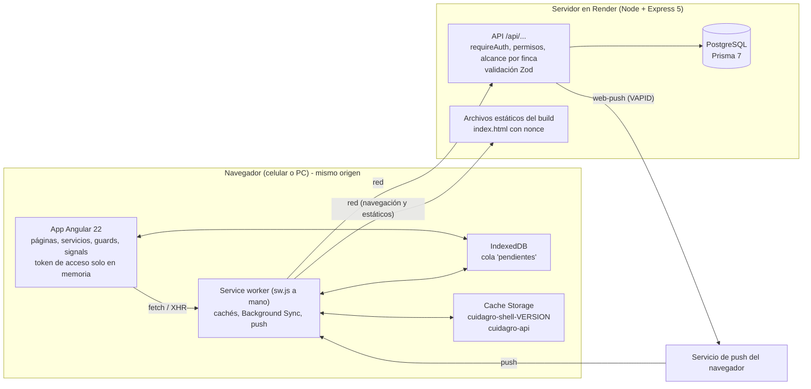
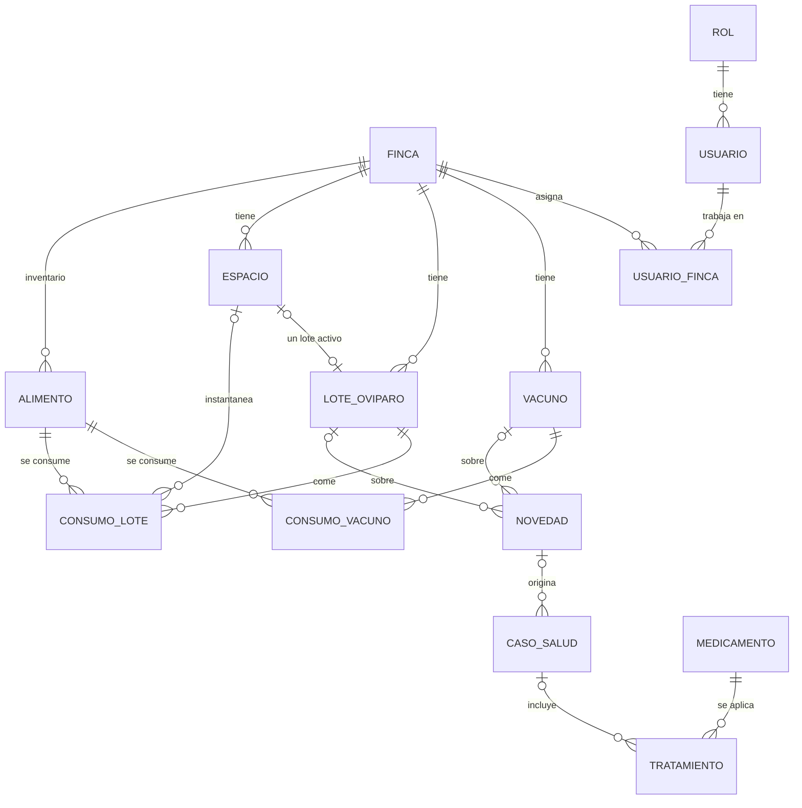

# Guía de estudio para la sustentación de CuidAgro

Electiva III – Progressive Web Applications. Esta guía es para estudiar y explicar el proyecto con tus propias palabras: qué estrategia usamos para cada cosa, por qué, cómo funciona paso a paso y dónde está en el código.

## Contenido

1. [Cómo usar esta guía y mapa general](#1-cómo-usar-esta-guía-y-mapa-general)
2. [Un capítulo por tema del curso](#2-un-capítulo-por-tema-del-curso)
   - 2.1 JavaScript asíncrono y promesas
   - 2.2 Conceptos de PWA
   - 2.3 Manifiesto e instalación
   - 2.4 Service worker y su ciclo de vida
   - 2.5 Estrategias de caché
   - 2.6 Modo sin conexión
   - 2.7 Background Sync
   - 2.8 Notificaciones push
   - 2.9 APIs del dispositivo: cámara, GPS y fotos
   - 2.10 Diseño responsive y mobile-first
   - 2.11 Seguridad
   - 2.12 Despliegue
   - 2.13 Auditoría y Web Vitals
3. [Lógica de negocio clave](#3-lógica-de-negocio-clave)
4. [Pruebas y calidad](#4-pruebas-y-calidad)
5. [Glosario](#5-glosario)
6. [Repaso final y guion de demo](#6-repaso-final-y-guion-de-demo)

---

## 1. Cómo usar esta guía y mapa general

### 1.1 Cómo usar esta guía

- Lee primero este mapa general (sección 1). Con él entiendes por dónde pasa una petición y qué hace cada pieza.
- Después estudia los capítulos en orden. Cada capítulo del curso tiene siempre las mismas seis partes:
  a) **Qué vimos en clase**, b) **Qué estrategia elegimos y por qué**, c) **Cómo funciona paso a paso**, d) **Dónde está** en el código, e) **Cómo demostrarlo** y f) **Preguntas que puede hacer el profesor**.
- Abre los archivos mencionados mientras lees. Las rutas son relativas a la raíz del repositorio. Los fragmentos de código son copias fieles del repositorio (a veces recortadas con `// …`).
- Al final hay un glosario (sección 5), 28 preguntas de autoevaluación y un guion de demo de 10 minutos (sección 6).
- Las citas "Sesión N" se refieren a las sesiones del curso. **Seis de los textos de las sesiones salen ilegibles** (la Sesión 3, la 9, la 12, la 13, el segundo documento de la 16 y el documento sin número). Por eso lo que corresponde a esas sesiones se explica con lo que enseñan las sesiones vecinas y está marcado como "no verificado contra el material".
- Cuando algo no se pudo verificar leyendo el código, la guía lo dice. Hay un resumen de esos puntos en la sección 6.4.

### 1.2 Qué es CuidAgro

CuidAgro es una PWA (aplicación web progresiva) para cuidar animales de granja: vacunos y lotes de aves (ovíparos). Permite:

- Registrar animales y lotes de aves, el inventario de alimento y lo que comió cada animal o lote.
- Registrar **novedades** (algo que pasó en la finca) con descripción, foto y ubicación GPS.
- Llevar la salud: casos, medicamentos, tratamientos y tiempo de retiro.
- Ver un panel de inicio con alertas y reportes de consumo por día o mes, por animal, lote o espacio del galpón.
- Trabajar **sin señal** (en el campo hay poca): lo que se registra queda en el celular y se envía cuando vuelve la conexión.
- Recibir avisos (notificaciones push) cuando hay una novedad urgente o poco inventario.

Es el proyecto final del grupo 3. Las 7 historias de usuario oficiales del Excel del curso son: registrar vacuno, registrar lote de ovíparo, registrar alimento, alimento consumido por ovíparo, alimento consumido por vacuno, registrar novedades (descripción, foto, GPS, lote) y reportes de consumo por día y mes, por animal o lote. Todas están implementadas (`docs/contexto-proyecto.md`). El resto del sistema (salud, medicamentos, espacios, push, etc.) amplía ese alcance.

### 1.3 Usuarios y roles

Hay tres roles con permisos fijos (`backend/src/lib/roles.js`). La API envía los permisos al frontend junto con la sesión y el frontend los usa solo para mostrar u ocultar menús y rutas. **La autorización real la hace siempre el servidor.**

| Rol | Qué hace | Detalles |
|---|---|---|
| `ADMINISTRADOR` | Gestiona usuarios, fincas y todo lo demás; es el único que ve la pantalla **Calidad** | Ve todas las fincas |
| `VETERINARIO` | Gestiona animales, alimentos, salud, medicamentos, tratamientos; ve reportes | Solo las fincas asignadas |
| `AYUDANTE` | Trabajador de campo: registra consumos y novedades, consulta lo demás | Solo las fincas asignadas; no ve Reportes; edita solo lo suyo del día |

Datos de la demo: finca **Doña Mery** (Ramiriquí), usuarios **Mery** (AYUDANTE) y **David** (VETERINARIO). Las contraseñas no están en este documento: pídelas al equipo.

### 1.4 Arquitectura

CuidAgro son dos aplicaciones en un solo servicio: una **PWA en Angular** (frontend, TypeScript) y una **API en Express** (backend, JavaScript) con **PostgreSQL**. En producción Express sirve las dos cosas desde el **mismo origen** `https://cuidagro.onrender.com`: la API bajo `/api/...` y el build de Angular en el resto de rutas. Eso es clave para la seguridad y para la cookie de sesión.



| Capa | Tecnología | Carpeta |
|---|---|---|
| Interfaz | Angular 22, TypeScript, componentes standalone, `signal`, sin zone.js | `frontend/src/app/` (`paginas/`, `core/`, `layout/`, `compartido/`) |
| PWA | `sw.js` en JavaScript plano escrito a mano, manifiesto, iconos | `frontend/public/`, `frontend/scripts/` |
| API | Node + Express 5 en JavaScript, Zod, helmet, web-push | `backend/src/` (`modules/`, `lib/`, `middleware/`, `config/`) |
| Datos | PostgreSQL con Prisma 7.10.1 (adaptador `pg`) | `backend/prisma/` |
| Despliegue | Render (Blueprint) | `render.yaml` |

Decisión de diseño importante: **no usamos `@angular/service-worker` ni librerías como Workbox**. Escribimos `sw.js` a mano, como en los talleres del curso, para poder explicar cada línea.

### 1.5 El recorrido de una petición

Ejemplo: el veterinario abre la lista de vacunos (`GET /api/vacunos?fincaId=…`).

1. El componente Angular llama a un servicio (`frontend/src/app/core/vacunos-api.ts`) que usa `HttpClient`.
2. El interceptor (`frontend/src/app/core/auth.interceptor.ts`) añade la cabecera `Authorization: Bearer <token de acceso>`. Si el servidor responde 401, renueva el token con la cookie y repite la petición.
3. La petición pasa por el **evento `fetch` del service worker** (`frontend/public/sw.js`). Como es un `GET` a `/api/` el SW usa *network-first*: intenta la red.
4. Express recibe la petición. Pasa por `helmet` (cabeceras de seguridad), `compression`, `express.json` y llega al router de vacunos.
5. `requireAuth` (`backend/src/middleware/auth.js`) verifica el JWT y **consulta el usuario en la base** (así, si lo desactivan, deja de funcionar al instante). `requirePermiso` revisa que el rol tenga el permiso.
6. El servicio del módulo filtra la consulta por las fincas del usuario (`filtroFincas`), valida las entradas con Zod y consulta PostgreSQL con Prisma.
7. La respuesta vuelve. El SW guarda una copia en la caché `cuidagro-api` (solo si es 2xx).
8. Si no hubiera red, el paso 3 habría respondido con la copia guardada marcada con la cabecera `X-Desde-Cache: 1`, y el interceptor habría hecho que se mostrara la banda "Datos guardados, pueden no estar al día".

Las escrituras (`POST`, `PATCH`, `DELETE`) **no** pasan por la caché: el SW las deja pasar tal cual. Lo que se registra sin conexión va por otro camino: la cola en IndexedDB (capítulo 2.6).

---

## 2. Un capítulo por tema del curso

### 2.1 JavaScript asíncrono y promesas

#### a) Qué vimos en clase

- **Sesión 2 (Introducción a JavaScript):** `const`/`let`, funciones flecha, `map`/`filter`/`reduce`, objetos, `?.` y `??`, desestructuración, DOM y eventos.
- **Sesión 5 (Promises):** una promesa representa un valor que llegará en el futuro. Tiene tres estados: *pending*, *fulfilled* y *rejected*. `then` devuelve otra promesa (se pueden encadenar), los errores viajan hasta el `catch`, `finally` corre siempre. `Promise.all` espera a todas, `Promise.allSettled` espera a todas sin rechazar nunca, `Promise.race` devuelve la primera que termine (bien o mal), `Promise.any` la primera que salga bien. `async`/`await` permite escribir código asíncrono que se lee como síncrono.
- **Sesión 6 (Taller):** ejercicios con `then`, `Promise.all`, `race`, `allSettled`, `any`, cadenas de promesas y `fetch` con promesas.

Por qué importa en una PWA: casi todo lo que hace un service worker es asíncrono (abrir cachés, hacer `fetch`, leer IndexedDB), y el SW termina si no le decimos con `waitUntil`/`respondWith` qué promesa esperar.

#### b) Qué estrategia elegimos y por qué

- Usamos **`async`/`await` con `try`/`catch`** como estilo principal porque se lee mejor y el manejo de errores queda en un solo lugar.
- Usamos los **combinadores de promesas solo donde resuelven un problema real**:
  - `Promise.race` para el límite de tiempo de la red en el SW (si en 6 s no llegó la respuesta y hay copia, gana la copia).
  - `Promise.all` para borrar varias cachés viejas al activarse el SW.
  - `Promise.allSettled` para enviar un push a varios dispositivos sin que uno que falle detenga a los demás.
  - `.catch().finally()` para que un fallo de push **nunca** cambie la respuesta de la API.
- La API de IndexedDB usa *callbacks* (`onsuccess`, `onerror`); la **envolvimos en promesas** (`new Promise`) para poder usar `await`.
- No usamos `Promise.any` (no hizo falta). Si el profesor lo pregunta: se usaría para "la primera fuente que responda bien", por ejemplo pedir un mismo recurso a dos servidores.
- En Angular, `HttpClient` devuelve *Observables* (RxJS). Los convertimos a promesa con `firstValueFrom` donde queremos usar `await`.

#### c) Cómo funciona paso a paso: el límite de tiempo "lie-fi"

*Lie-fi* es un término de la industria (no lo encontré en el texto de las sesiones que pude leer) para una conexión que dice tener señal pero no entrega datos. Para no dejar al usuario esperando para siempre, competimos la red contra un temporizador:

1. Se lanza el `fetch` a la red (promesa `red`).
2. Se crea una promesa `limite` que se resuelve con `null` a los 6 s.
3. `Promise.race([red, limite])` devuelve la primera que termine.
4. Si ganó la red, se responde con la respuesta de la red.
5. Si ganó el temporizador (`null`) y hay copia guardada, se responde con la copia marcada `X-Desde-Cache`. Si no hay copia, se espera a la red.

```js
// frontend/public/sw.js (redPrimeroApi, recortado)
  // Temporizador: si la red se demora y hay copia, gana la copia.
  const limite = new Promise((resolver) => setTimeout(() => resolver(null), ESPERA_RED_MS));

  try {
    const primera = await Promise.race([red, limite]);
    if (primera) return primera;
    const guardada = await cache.match(peticion, { ignoreVary: true });
    return guardada ? marcarDesdeCache(guardada) : await red;
  } catch {
    const guardada = await cache.match(peticion, { ignoreVary: true });
    if (guardada) return marcarDesdeCache(guardada);
    throw new TypeError('Sin conexión y sin copia guardada');
  }
```

Otros dos ejemplos para citar:

```js
// frontend/public/sw.js (activate): Promise.all para borrar varias cachés a la vez
      const nombres = await caches.keys();
      await Promise.all(
        nombres.filter((n) => n.startsWith(PREFIJO_SHELL) && n !== CACHE_SHELL).map((n) => caches.delete(n)),
      );
      await self.clients.claim();
```

```js
// backend/src/lib/push.js: lanzar() atrapa cualquier error; notificar() usa allSettled
function lanzar(tarea) {
  const promesa = Promise.resolve()
    .then(tarea)
    .catch((error) => {
      if (env.NODE_ENV !== 'test') console.error('Error al enviar notificaciones push:', error);
    })
    .finally(() => pendientes.delete(promesa));
  pendientes.add(promesa);
  return promesa;
}
// …
  await Promise.allSettled(usuarios.flatMap((u) => u.suscripcionesPush.map((s) => enviarA(s, carga))));
```

Y la API de IndexedDB envuelta en una promesa:

```js
// frontend/public/sw.js
function abrirBd() {
  return new Promise((resolver, rechazar) => {
    const peticion = indexedDB.open(BD_NOMBRE, BD_VERSION);
    // …
    peticion.onsuccess = () => resolver(peticion.result);
    peticion.onerror = () => rechazar(peticion.error);
  });
}
```

Un detalle fino: `red.catch(() => undefined)` se escribe aparte porque, si la petición pierde la carrera contra el temporizador y falla después, nadie atendería ese error y quedaría como "promesa rechazada sin capturar".

#### d) Dónde está

| Qué | Archivo y función |
|---|---|
| `Promise.race` (límite 6 s) | `frontend/public/sw.js`, `redPrimeroApi` |
| `Promise.all` | `frontend/public/sw.js`, evento `activate` |
| `allSettled`, `catch`, `finally` | `backend/src/lib/push.js`, `notificar`, `lanzar`, `esperarEnvios` |
| IndexedDB con promesas | `frontend/public/sw.js` (`abrirBd`, `pedir`, `escribir`) y `frontend/src/app/core/cola-offline.ts` |
| `async`/`await` en la sincronización | `frontend/src/app/core/sincronizador.ts`, `sincronizar` y `enviar` |
| RxJS a promesa | `frontend/src/app/core/auth.ts` (`restaurar` usa `firstValueFrom`) |
| Import dinámico | `frontend/src/app/core/metricas.ts` (`await import('web-vitals')`) |

#### e) Cómo demostrarlo

1. Abre `frontend/public/sw.js` y muestra `redPrimeroApi`: explica la carrera entre la red y el temporizador.
2. En DevTools > Network, pon la red en "Slow 3G" o bloquea la URL `/api/vacunos` con "Block request URL" estando con sesión iniciada; tras unos segundos la lista aparece con la banda amarilla "Datos guardados, pueden no estar al día". (La copia solo existe si antes visitaste esa lista con red.)
3. Muestra `push.js` y explica por qué un fallo de push no debe afectar la respuesta de la API.

#### f) Preguntas que puede hacer el profesor

1. **¿Qué diferencia hay entre `Promise.all` y `Promise.allSettled`?** `all` se rechaza apenas una falla; `allSettled` espera a todas y devuelve el estado de cada una. En push usamos `allSettled` para que un dispositivo caído no corte el envío a los demás.
2. **¿Para qué usan `Promise.race` en el service worker?** Para limitar la espera de la red a 6 s cuando hay una copia guardada, de modo que con una conexión "con señal pero sin datos" el usuario vea algo.
3. **¿Por qué `fetch` no rechaza con un 404 o 500?** Porque la promesa solo se rechaza ante fallos de red; hay que revisar `respuesta.ok`. Por eso el SW solo guarda en caché cuando `respuesta.ok` es verdadero (nunca un 401 o un 500).
4. **¿Por qué envolvieron IndexedDB en promesas?** Su API original usa eventos y *callbacks*. Con `new Promise` y `resolver`/`rechazar` podemos usar `await` y encadenar con el resto del código.
5. **¿Qué hace `evento.waitUntil`?** Le dice al navegador que no termine el service worker hasta que la promesa se resuelva (por ejemplo, mientras guarda en caché o envía la cola).

---

### 2.2 Conceptos de PWA

#### a) Qué vimos en clase

- **Sesión 3 (Conceptos fundamentales de PWA I):** qué es una PWA y sus características. *Este texto salió ilegible; lo que sigue es lo que enseñan las sesiones vecinas y no está verificado contra el material de la Sesión 3.*
- **Sesión 4 (Conceptos fundamentales de PWA II):** el service worker como proceso en segundo plano que hace de proxy de red; sus eventos (`fetch`, `push`, `sync`); `fetch` y `navigator.onLine`/`navigator.serviceWorker`; el ciclo de vida.

Una PWA es una aplicación web que se comporta como una app nativa. Se resume en tres rasgos: **instalable** (manifiesto), **fiable** (funciona sin red gracias al service worker y a la caché) y **rápida/atractiva** (carga rápido, responde bien, se ve bien en celular). Exige **HTTPS** (salvo `localhost`).

#### b) Qué estrategia elegimos y por qué

| Rasgo PWA | Cómo lo cumple CuidAgro |
|---|---|
| Instalable | `manifest.webmanifest` con nombre, iconos, `display: standalone`, shortcuts y screenshots; botón "Instalar app" |
| Fiable sin red | `sw.js` con precaché y estrategias de caché; cola de registros en IndexedDB; sesión sin conexión |
| Rápida | Rutas con carga diferida (`loadComponent`), archivos con hash y caché de un año, `compression`, Angular sin zone.js, imágenes WebP |
| Re-enganche | Notificaciones push |
| Segura | HTTPS en Render, CSP, cookies seguras |
| Adaptable | Mobile-first: 375 px, botones de 48 px |

La razón de elegir PWA y no app nativa: los trabajadores de campo usan celulares muy distintos, no hay que pasar por tiendas de aplicaciones y una sola base de código sirve para celular y computador.

#### c) Cómo funciona paso a paso (de la primera visita a usar sin red)

1. El usuario abre `https://cuidagro.onrender.com` (HTTPS). Express responde `index.html` y los archivos del build.
2. Angular arranca (`frontend/src/main.ts`), restaura la sesión (`Auth.restaurar`) y llama a `Pwa.iniciar()` (`frontend/src/app/app.config.ts`).
3. `Pwa.registrar()` llama a `navigator.serviceWorker.register('/sw.js')` (solo en producción).
4. El navegador descarga `sw.js` y dispara `install`: el SW guarda el "shell" (HTML, JS, CSS, iconos) en `cuidagro-shell-<versión>`.
5. Al activarse (`activate`), el SW toma control de la página (`clients.claim()`).
6. A partir de ahí, cada petición de la página pasa por el SW. Con red se usa la red; sin red se usa la copia.
7. Si el navegador cumple los criterios de instalabilidad, dispara `beforeinstallprompt` y la app muestra "Instalar app" en el menú de cuenta.

#### d) Dónde está

`frontend/public/manifest.webmanifest`, `frontend/public/sw.js`, `frontend/src/app/core/pwa.ts`, `frontend/src/app/app.config.ts`, `render.yaml`.

#### e) Cómo demostrarlo

1. Abre la app en Chrome. DevTools > Application: muestra **Manifest**, **Service workers** (estado "activated and is running") y **Cache storage**.
2. Pon Network en "Offline" y recarga: la app abre con la sesión guardada y la banda "Sin conexión".
3. Muestra el candado HTTPS de la barra de direcciones.

#### f) Preguntas que puede hacer el profesor

1. **¿Qué hace que una app web sea una PWA?** Manifiesto, service worker y HTTPS, con la experiencia de instalable, fiable y rápida.
2. **¿Por qué hace falta HTTPS?** Porque un service worker puede interceptar todas las peticiones; sin cifrado, un atacante en la red podría suplantarlo. Los navegadores solo registran service workers en HTTPS o en `localhost`. Render termina el TLS y nosotros además enviamos HSTS.
3. **¿Qué diferencia hay entre una PWA y una página web responsive normal?** Una web responsive solo adapta el diseño; una PWA además es instalable, funciona sin red, puede recibir push y se abre en su propia ventana.
4. **¿Por qué no usaron Workbox ni `@angular/service-worker`?** Decisión con el usuario: escribir `sw.js` a mano como en los talleres del curso para entender y poder explicar cada evento. A cambio, nos tocó mantener a mano la lista de precaché (lo automatiza `sw-precache.mjs`).
5. **¿Qué pasa en `ng serve` con el service worker?** No se registra a propósito (`isDevMode()`), para no servir código viejo mientras se desarrolla. Lo offline se prueba con `npm run build` y `npm run preview`.

---

### 2.3 Manifiesto e instalación

#### a) Qué vimos en clase

- **Sesión 10 (Despliegue en dispositivos):** un único manifiesto por aplicación enlazado desde el HTML; campos `name`, `start_url`, `icons` (`src`, `sizes`, `type`), `background_color`, `theme_color`, `display: standalone`, `orientation` y `screenshots` (para la ventana de instalación enriquecida).
- **Sesión 11 (Taller de despliegue 2):** para instalar en Android hacen falta `description` y `scope`; el taller publica en GitHub Pages con HTTPS y propone investigar cómo instalar en iOS.

#### b) Qué estrategia elegimos y por qué

- Manifiesto **completo** (todos los campos que menciona el curso, más `id`, `shortcuts` y `categories`).
- `display: standalone`: la app se abre sin barra del navegador, como una app nativa.
- `orientation: portrait`: el uso de campo es con el celular en vertical. (Antes de la Fase 11 se había dejado libre; ahora está fijada.)
- Iconos 192, 512 y 512 *maskable* (el maskable deja un margen seguro para que Android pueda recortarlo en círculo o cuadrado redondeado).
- **Shortcuts**: accesos directos al mantener pulsado el icono, a las dos tareas más frecuentes de campo (registrar consumo y nueva novedad).
- **Screenshots** (una `narrow` y una `wide`) para que el cuadro de instalación muestre la app.
- `apple-touch-icon` en el HTML aparte, porque iOS no usa el manifiesto para el icono.

#### c) Cómo funciona paso a paso

1. `frontend/src/index.html` enlaza el manifiesto con `<link rel="manifest" href="manifest.webmanifest">` y declara `theme-color`.
2. Angular copia `frontend/public/` al build (así `manifest.webmanifest`, `sw.js` e `icons/` quedan en la raíz del sitio).
3. Express sirve el manifiesto con `Cache-Control: no-cache` para que los cambios lleguen.
4. El navegador evalúa los criterios de instalabilidad (manifiesto válido, iconos, `start_url`, service worker, HTTPS) y dispara `beforeinstallprompt`.
5. `Pwa.iniciar()` guarda el evento (`e.preventDefault()`) y pone `instalable` en verdadero; el menú de cuenta muestra "Instalar app".
6. Al pulsar, `Pwa.instalar()` llama a `evento.prompt()` y espera la elección del usuario.

```json
// frontend/public/manifest.webmanifest (recortado)
{
  "id": "/",
  "name": "CuidAgro",
  "short_name": "CuidAgro",
  "start_url": "/",
  "scope": "/",
  "display": "standalone",
  "orientation": "portrait",
  "background_color": "#f7f3e9",
  "theme_color": "#24512f",
  "icons": [
    { "src": "icons/icon-192.png", "sizes": "192x192", "type": "image/png", "purpose": "any" },
    { "src": "icons/icon-512.png", "sizes": "512x512", "type": "image/png", "purpose": "any" },
    { "src": "icons/icon-maskable-512.png", "sizes": "512x512", "type": "image/png", "purpose": "maskable" }
  ],
  "shortcuts": [
    {
      "name": "Registrar consumo",
      "short_name": "Consumo",
      "url": "/consumos",
      "icons": [{ "src": "icons/icon-96.png", "sizes": "96x96", "type": "image/png" }]
    }
    // … otro shortcut: "Nueva novedad" → /novedades
  ],
  "screenshots": [
    {
      "src": "img/capturas/movil.webp",
      "sizes": "1080x1920",
      "type": "image/webp",
      "form_factor": "narrow",
      "label": "Inicio de CuidAgro en el celular"
    }
    // … y la captura "wide" 1920x1080 (escritorio.webp)
  ]
}
```

```ts
// frontend/src/app/core/pwa.ts
window.addEventListener('beforeinstallprompt', (e) => {
  e.preventDefault(); // se guarda para mostrar "Instalar app" cuando el usuario quiera
  this.eventoInstalar = e as EventoInstalar;
  this.instalable.set(true);
});
// …
async instalar(): Promise<void> {
  const evento = this.eventoInstalar;
  if (!evento) return;
  await evento.prompt();
  await evento.userChoice;
  this.eventoInstalar = null;
  this.instalable.set(false);
}
```

```html
<!-- frontend/src/index.html (cabecera) -->
<meta name="theme-color" content="#24512f">
<link rel="manifest" href="manifest.webmanifest">
<link rel="apple-touch-icon" href="icons/apple-touch-icon.png">
```

**Punto a verificar antes de presentar:** el manifiesto declara las capturas en `img/capturas/movil.webp` y `img/capturas/escritorio.webp`, pero **al revisar el repositorio esa carpeta (`frontend/public/img/capturas/`) no existía**. Si los archivos no están, DevTools mostrará un error en Manifest y la instalación enriquecida no mostrará las imágenes. Confirma con quien los genera que estén antes del despliegue.

#### d) Dónde está

`frontend/public/manifest.webmanifest`, `frontend/src/index.html`, `frontend/public/icons/`, `frontend/src/app/core/pwa.ts` (`iniciar`, `instalar`), `frontend/src/app/layout/shell.ts` (botón "Instalar app" en el menú de cuenta), `backend/src/app.js` (`no-cache` del manifiesto).

#### e) Cómo demostrarlo

1. DevTools > Application > **Manifest**: nombre, colores, `scope`, iconos (incluida la vista del maskable), **Shortcuts** y **Screenshots**. En "Installability" no debe haber errores.
2. En Chrome de escritorio, icono de instalar en la barra de direcciones, o menú de cuenta > "Instalar app".
3. En Android: menú de Chrome > "Instalar app"; abrir y mostrar que no hay barra del navegador; mantener pulsado el icono para ver los shortcuts. (La prueba en un Android real figura como pendiente en `docs/fases/fase-09-despliegue.md`; no se verificó.)

#### f) Preguntas que puede hacer el profesor

1. **¿Para qué sirve `display: standalone`?** Abre la app en su propia ventana, sin la interfaz del navegador, como una app nativa.
2. **¿Qué es `scope` y `start_url`?** `start_url` es la página que abre la app instalada; `scope` define qué URLs pertenecen a la app. Ambas son `/` porque toda la app cuelga de la raíz.
3. **¿Para qué sirve el icono *maskable*?** Android recorta los iconos con distintas formas; el maskable lleva el dibujo dentro de una "zona segura" para que no se corte.
4. **¿Qué son los shortcuts y los screenshots?** Shortcuts: atajos al mantener pulsado el icono (Registrar consumo, Nueva novedad). Screenshots: capturas que el navegador usa en la ventana de instalación enriquecida, con `form_factor` `narrow` (celular) y `wide` (escritorio).
5. **¿Cómo se instala en iOS?** Safari no dispara `beforeinstallprompt`; se instala con Compartir > "Añadir a pantalla de inicio", y el icono sale de `apple-touch-icon`. En iOS no probamos la instalación (no verificado).

---

### 2.4 Service worker y su ciclo de vida

#### a) Qué vimos en clase

**Sesión 4:** el service worker es un script que corre aparte de la página (sin acceso al DOM) y hace de proxy. Ciclo de vida: **descarga**, **instalación** (si el archivo cambió byte a byte), **en espera** (*waiting*, hasta que no queden pestañas con la versión anterior), **activación** (se limpian cachés viejas), **activado** (controla el `scope`) y ocioso/terminado. Se registra con `navigator.serviceWorker.register`. Una página recién cargada no queda controlada hasta recargar (salvo `clients.claim()`). El navegador revisa el archivo cada ~24 horas. `skipWaiting()` salta la espera.

**Sesión 7:** el `install` es el momento de guardar el *app shell* con `cache.addAll`; si un archivo falla, falla la instalación.

#### b) Qué estrategia elegimos y por qué

| Decisión | Motivo |
|---|---|
| **No** llamar a `skipWaiting()` en `install` | Si la versión nueva tomara control sola, el código podría cambiar mientras alguien llena un formulario (por ejemplo, un registro de campo). |
| Avisar con la banda "Hay una versión nueva de CuidAgro" y botón **Actualizar** | El usuario decide cuándo actualizar; al pulsar, la app envía el mensaje `SKIP_WAITING` y recarga. |
| `clients.claim()` en `activate` | En la primera visita, la pestaña ya abierta queda controlada sin recargar. |
| Nombre de caché con versión (`cuidagro-shell-<versión>`) y borrado de las viejas en `activate` | Cada build tiene su propia caché; las anteriores se eliminan. |
| La **versión se genera en el build** (hash del contenido) | El SW cambia solo cuando cambia la app, y la lista de precaché lleva los nombres con hash que solo se conocen al terminar `ng build`. |
| `sw.js`, `index.html` y el manifiesto con `Cache-Control: no-cache` | Para que el navegador detecte versiones nuevas. |
| La app llama `registro.update()` al volver a la pestaña | No esperar 24 horas para buscar versión nueva. |
| Registro solo en producción | Evitar servir código viejo con `ng serve`. |

#### c) Cómo funciona paso a paso

**Generación de la versión (en el build).** `npm run build` en `frontend/` ejecuta `ng build && node scripts/sw-precache.mjs`. El script recorre la carpeta `dist/frontend/browser`, calcula un hash SHA-256 de los archivos y reemplaza dos marcadores en el `sw.js` ya compilado: la versión y la lista de archivos.

```js
// frontend/public/sw.js (valores por defecto; el script los reemplaza)
const VERSION = /*VERSION_INICIO*/ 'dev' /*VERSION_FIN*/;
const ARCHIVOS_PRECACHE = /*PRECACHE_INICIO*/ ['/', '/index.html'] /*PRECACHE_FIN*/;
const CACHE_SHELL = 'cuidagro-shell-' + VERSION;
```

```js
// frontend/scripts/sw-precache.mjs (recortado)
const archivos = listar(salida)
  .map((ruta) => relative(salida, ruta).split(sep).join('/'))
  .filter((r) => r !== 'sw.js' && !r.endsWith('.map') && r !== '3rdpartylicenses.txt')
  .sort();

const urls = ['/', ...archivos.map((r) => '/' + r)];
const huella = createHash('sha256');
for (const r of archivos) huella.update(r).update(readFileSync(join(salida, r)));
const version = huella.digest('hex').slice(0, 12);
// … reemplaza los marcadores y comprueba la sintaxis del sw.js resultante
console.log(`sw.js: versión ${version}, ${urls.length} URL en el precaché`);
```

El script además revisa que el `sw.js` resultante no tenga errores de sintaxis (`new Script(...)`), porque el SW no pasa por el compilador de Angular y un error lo dejaría apagado. La documentación de la Fase 8 menciona unas 50 URL en el precaché; el número exacto lo imprime el build.

**Ciclo de vida en ejecución:**

1. **Registro.** `Pwa.registrar()` llama a `navigator.serviceWorker.register('/sw.js')`.
2. **`install`.** Abre `cuidagro-shell-<versión>` y hace `addAll` con `cache: 'reload'` (para saltarse la caché HTTP del navegador). Si un archivo falla, falla la instalación y se conserva el SW anterior.
3. **Espera.** Si ya había un SW activo, el nuevo queda en *waiting*.
4. **Aviso.** `Pwa.registrar()` escucha `updatefound` y `statechange`: cuando el SW nuevo llega a `installed` y ya hay un controlador activo, pone `actualizacionLista` en verdadero y `BandaEstado` muestra la banda.
5. **Actualizar.** `Pwa.actualizar()` envía `{ tipo: 'SKIP_WAITING' }` al SW en espera; el SW llama a `self.skipWaiting()`.
6. **`activate`.** Borra las cachés `cuidagro-shell-*` distintas de la actual y llama a `clients.claim()`.
7. **Recarga.** El evento `controllerchange` hace `window.location.reload()` (solo si el usuario pidió actualizar).

```js
// frontend/public/sw.js
self.addEventListener('install', (evento) => {
  evento.waitUntil(
    caches
      .open(CACHE_SHELL)
      .then((cache) => cache.addAll(ARCHIVOS_PRECACHE.map((url) => new Request(url, { cache: 'reload' })))),
  );
});

self.addEventListener('message', (evento) => {
  const tipo = evento.data && evento.data.tipo;
  if (tipo === 'SKIP_WAITING') {
    self.skipWaiting();
  } else if (tipo === 'BORRAR_CACHE_API') {
    evento.waitUntil(caches.delete(CACHE_API));
  } // … y 'VERSION'
});
```

```ts
// frontend/src/app/core/pwa.ts (registrar, recortado)
this.registro = await navigator.serviceWorker.register('/sw.js');
// …
if (registro.waiting && navigator.serviceWorker.controller) this.actualizacionLista.set(true);
registro.addEventListener('updatefound', () => {
  const nuevo = registro.installing;
  nuevo?.addEventListener('statechange', () => {
    // "installed" con un controlador activo = es una actualización, no la primera instalación.
    if (nuevo.state === 'installed' && navigator.serviceWorker.controller) this.actualizacionLista.set(true);
  });
});
// …
actualizar(): void {
  this.recargarAlCambiar = true;
  this.registro?.waiting?.postMessage({ tipo: 'SKIP_WAITING' });
}
```

#### d) Dónde está

`frontend/public/sw.js` (constantes, `install`, `activate`, `message`), `frontend/scripts/sw-precache.mjs`, `frontend/package.json` (script `build`), `frontend/src/app/core/pwa.ts`, `frontend/src/app/compartido/banda-estado.ts`, `backend/src/app.js` (`setHeaders` de `express.static`).

#### e) Cómo demostrarlo

1. DevTools > Application > Service workers: `sw.js` "activated and is running", `scope` `/`. Application > Cache storage: `cuidagro-shell-<hash>`.
2. Network > filtra `sw.js` y muestra `cache-control: no-cache`.
3. Ciclo de vida: con la app abierta, compila y sirve una versión nueva (`npm run build`, `npm run preview`) y vuelve a la pestaña. En Application aparece el SW nuevo "waiting to activate" y en la app la banda "Hay una versión nueva". Pulsa **Actualizar** y observa cómo pasa a activo y se recarga.
4. Muestra el hash en la consola del build (`sw.js: versión …`).

#### f) Preguntas que puede hacer el profesor

1. **¿Cuándo se ejecuta `install` y cuándo `activate`?** `install` una vez por versión del archivo (guardamos el shell); `activate` cuando esa versión pasa a ser la activa (borramos cachés viejas y tomamos control).
2. **¿Por qué no usan `skipWaiting()` automático?** Para no cambiar el código a mitad de un formulario. Preferimos avisar y dejar que el usuario actualice.
3. **¿Cómo sabe el navegador que hay un SW nuevo?** Compara `sw.js` byte a byte con el instalado. Por eso la versión (hash) se escribe dentro del archivo en el build: si cambia algo de la app, cambia `sw.js` y el navegador lo instala.
4. **¿Qué pasa si falla un archivo durante `install`?** Falla la instalación, se descarta ese SW y sigue funcionando el anterior.
5. **¿Qué hace `clients.claim()`?** Hace que las pestañas ya abiertas pasen a ser controladas por el SW recién activado, sin tener que recargar.
6. **¿Por qué el caché de la API no lleva versión?** Para que los datos del usuario sobrevivan a una actualización de la app; se borra al cerrar sesión.

---
### 2.5 Estrategias de caché

#### a) Qué vimos en clase

- **Sesión 7 (Introducción a las estrategias de caching):** no basta con responder texto plano; se usa la **Cache Storage API** (`caches.open`, `has`, `delete`, `match`, `put`, `addAll`, `keys`). Se guarda el *app shell* durante `install`.
- **Sesión 8 (Estrategias de caching):** no hay una estrategia que sirva para todo; se combinan.
  - *Cache Only*: el recurso debe estar ya guardado (ideal para el shell estático).
  - *Cache with network fallback* (cache-first): primero la caché; si no está, la red y se guarda.
  - *Network with cache fallback* (network-first): primero la red; si falla, la caché (ideal para contenido dinámico).
  - Cachés separadas (estática, dinámica, inmutable) y **limitar la caché** con la función `limitarCache(nombre, máximo)`, que borra las entradas más antiguas.
- **Sesión 9:** este texto salió ilegible; no verificado si cubrió otras estrategias (por ejemplo *stale-while-revalidate*).

#### b) Qué estrategia elegimos y por qué

Elegimos una estrategia **por tipo de recurso**, en el evento `fetch` de `sw.js`:

| Petición | Estrategia | Por qué |
|---|---|---|
| Archivos del shell (JS, CSS, iconos, imágenes) | **Precaché al instalar + cache-first** | Llevan hash en el nombre: su contenido nunca cambia, así que la copia guardada siempre es válida y la app abre sin red |
| Navegación (`/vacunos`, `/pendientes`…) | **Network-first** con respaldo a `/index.html` | Siempre el HTML más reciente; sin red, la SPA arranca desde el `index.html` precacheado y Angular dibuja la ruta |
| `GET /api/**` (menos `/api/auth/**`) | **Network-first** con límite de 6 s ("lie-fi") y respaldo en caché | Los datos cambian; sin red se usan los últimos conocidos, marcados con `X-Desde-Cache: 1` para avisar que pueden estar desactualizados |
| `POST`, `PATCH`, `DELETE` | No se interceptan | Las escrituras sin red van por la cola de IndexedDB, no por la caché |
| `/api/auth/**` | No se intercepta | Tokens y cookies **nunca** pasan por la caché |
| Otros orígenes | No se interceptan | No hay recursos externos propios (el mapa es un enlace a OpenStreetMap) |

**Qué nunca se cachea:** las escrituras, `/api/auth/**`, las respuestas que no sean `ok` (un 401 o 500 no se guarda) y los recursos de otros orígenes. 

**Las fotos sí se guardan en caché, a propósito.** La foto de una novedad se pide con `GET /api/novedades/:id/foto` (`NovedadesApi.foto`) y pasa por `redPrimeroApi` como cualquier otra lectura de la API: queda en `cuidagro-api`, cuenta para el tope de 150 entradas y **se borra al cerrar sesión** (mensaje `BORRAR_CACHE_API`). Se decidió así para que Doña Mery pueda ver las fotos de las novedades sin señal; tratarlas aparte no aporta seguridad, porque el resto de datos del usuario ya vive en esa misma caché y se borra igual.

Dos cachés, con otra separación que la del curso:

| Caché | Nombre | Contenido | Ciclo |
|---|---|---|---|
| Shell | `cuidagro-shell-<versión>` | HTML, JS, CSS, iconos | Una por build; `activate` borra las viejas |
| API | `cuidagro-api` | Respuestas GET de la API | Sin versión (sobrevive a actualizaciones); se borra al cerrar sesión; **limitada a 150 entradas** |

Alternativas descartadas:

- *Cache-first para la API*: mostraría datos viejos aunque haya red.
- *Network-first sin límite de tiempo*: con "lie-fi" el usuario esperaría mucho.
- Una página `offline.html` dedicada (como en la Sesión 7): preferimos servir el `index.html` precacheado para que Angular dibuje la ruta. Consecuencia: una lista que nunca se abrió con red no tiene datos sin conexión (los catálogos de los formularios sí, porque se precargan).

#### c) Cómo funciona paso a paso

**1. El enrutador del `fetch`:**

```js
// frontend/public/sw.js
self.addEventListener('fetch', (evento) => {
  const peticion = evento.request;

  // Si no llamamos a respondWith(), el navegador hace la petición normal.
  if (peticion.method !== 'GET') return;

  const url = new URL(peticion.url);
  if (url.origin !== self.location.origin) return;
  if (url.pathname.startsWith('/api/auth/')) return;

  if (url.pathname.startsWith('/api/')) {
    evento.respondWith(redPrimeroApi(peticion, evento));
    return;
  }
  if (peticion.mode === 'navigate') {
    evento.respondWith(redPrimeroNavegacion(peticion));
    return;
  }
  evento.respondWith(cachePrimero(peticion));
});
```

**2. Cache-first del shell:** se busca en la caché; si está, se devuelve sin red; si no, se pide a la red y, si la respuesta es `ok`, se guarda una copia.

```js
async function cachePrimero(peticion) {
  const cache = await caches.open(CACHE_SHELL);
  const guardada = await cache.match(peticion);
  if (guardada) return guardada;
  const respuesta = await fetch(peticion);
  if (respuesta.ok) cache.put(peticion, respuesta.clone());
  return respuesta;
}
```

**3. Network-first de la navegación:** se intenta la red; si falla, el `index.html` precacheado.

```js
async function redPrimeroNavegacion(peticion) {
  try {
    return await fetch(peticion);
  } catch {
    const cache = await caches.open(CACHE_SHELL);
    return (await cache.match('/index.html')) || (await cache.match('/')) || Response.error();
  }
}
```

**4. Network-first de la API con límite de tiempo:** (la carrera `Promise.race` ya está explicada en 2.1). Cada respuesta `ok` se guarda y luego se aplica `limitarCache`. Si se sirve la copia, se le añade `X-Desde-Cache: 1`.

```js
// frontend/public/sw.js (redPrimeroApi, parte de arriba)
  const red = fetch(peticion).then((respuesta) => {
    // Solo se guardan respuestas correctas: nunca un 401 ni un 500.
    if (respuesta.ok) {
      const guardado = cache.put(peticion, respuesta.clone()).then(() => limitarCache(cache, MAX_ENTRADAS_API));
      try {
        evento.waitUntil(guardado);
      } catch {
        // El evento ya terminó (respuesta tardía): el guardado sigue por su cuenta.
      }
      guardado.catch(() => undefined);
    }
    return respuesta;
  });
```

**5. `limitarCache` y la marca `X-Desde-Cache`:**

```js
async function limitarCache(cache, maximo) {
  const claves = await cache.keys();
  const sobran = claves.length - maximo;
  for (let i = 0; i < sobran; i++) await cache.delete(claves[i]);
}

async function marcarDesdeCache(respuesta) {
  const cabeceras = new Headers(respuesta.headers);
  cabeceras.set('X-Desde-Cache', '1');
  return new Response(await respuesta.blob(), {
    status: respuesta.status,
    statusText: respuesta.statusText,
    headers: cabeceras,
  });
}
```

La caché devuelve sus claves en orden de inserción, por eso borrar desde el índice 0 elimina las más antiguas. Es la misma idea que `limitarCache` de la Sesión 8, solo que esa es recursiva y borra de a una (`solicitudes[0]`). El tope es `MAX_ENTRADAS_API = 150`. Se necesita porque la caché se indexa por URL completa: cada filtro distinto (otra finca, otro rango de fechas) crea una entrada nueva.

**6. La app se entera:** el interceptor lee la cabecera y la banda se muestra.

```ts
// frontend/src/app/core/auth.interceptor.ts
const registrar = tap((evento: HttpEvent<unknown>) => {
  if (evento instanceof HttpResponse && req.method === 'GET') {
    conexion.registrarRespuesta(evento.headers.get('X-Desde-Cache') === '1');
  }
});
```

**7. Precarga de catálogos:** `Precarga` (`frontend/src/app/core/precarga.ts`) consulta vacunos, lotes, alimentos y raciones al iniciar sesión, cambiar de finca y volver la señal, con **los mismos parámetros que usan los formularios**. Esto importa porque la caché se indexa por URL completa: si la precarga usara otra URL, el formulario sin red no encontraría la copia.

**8. Borrado al cerrar sesión:** `Auth.limpiar()` envía `{ tipo: 'BORRAR_CACHE_API' }` al SW, que ejecuta `caches.delete(CACHE_API)`. Motivo: los datos guardados son de un usuario y el dispositivo podría usarlo otra persona.

#### d) Dónde está

`frontend/public/sw.js` (`fetch`, `cachePrimero`, `redPrimeroNavegacion`, `redPrimeroApi`, `limitarCache`, `marcarDesdeCache`, `message`), `frontend/src/app/core/conexion.ts`, `frontend/src/app/core/auth.interceptor.ts`, `frontend/src/app/core/precarga.ts`, `frontend/src/app/core/auth.ts` (`borrarCacheDeLaApi`), `frontend/src/app/compartido/banda-estado.ts`.

#### e) Cómo demostrarlo

1. Application > Cache storage > `cuidagro-shell-<hash>`: muestra los archivos precacheados. Abre `cuidagro-api`: las respuestas `/api/...`.
2. Inicia sesión, visita Vacunos y Alimentación. Marca "Offline" (Network o Application > Service workers) y recarga `/vacunos`: abre y muestra los datos guardados con la banda amarilla "Datos guardados, pueden no estar al día".
3. En Network, la columna Size dice "(ServiceWorker)"; en las peticiones `/api` servidas desde la copia aparece la cabecera de respuesta `x-desde-cache: 1`.
4. Como en la Sesión 8, borra un archivo del shell en Cache storage y recarga: se vuelve a descargar de la red (cache-first: si falta, pide a la red).
5. Cierra sesión y muestra que `cuidagro-api` desaparece.

#### f) Preguntas que puede hacer el profesor

1. **¿Qué diferencia hay entre cache-first y network-first y dónde usan cada una?** Cache-first mira primero la caché (shell con hash: nunca cambia). Network-first mira primero la red y cae a la caché (navegación y API: lo nuevo importa).
2. **¿Por qué la navegación es network-first y no cache-first?** Para tener siempre el `index.html` más reciente (que referencia los JS nuevos). Sin red, se usa el precacheado.
3. **¿Qué es "lie-fi" y cómo lo manejan?** Conexión con señal pero sin datos. Competimos la red contra un temporizador de 6 s; si hay copia guardada, gana la copia.
4. **¿Qué es `X-Desde-Cache` y para qué sirve?** Una cabecera que el SW añade a la respuesta servida desde la caché; la app la lee y muestra "Datos guardados, pueden no estar al día", para que el usuario sepa que no es lo último.
5. **¿Qué nunca se guarda en caché y por qué?** Escrituras, `/api/auth/**` (tokens y cookies), respuestas con error y otros orígenes. Un token en caché sería un riesgo de seguridad.
6. **¿Cómo evitan que la caché crezca sin fin?** `limitarCache` con tope de 150 entradas: borra las más antiguas (orden de inserción), como en la Sesión 8.
7. **¿Qué pasa con la caché al cerrar sesión?** La app pide al SW borrar `cuidagro-api`.

---

### 2.6 Modo sin conexión

#### a) Qué vimos en clase

- **Sesiones 12 y 13:** ilegibles; el tema (IndexedDB) no está verificado contra el material.
- **Sesión 14 (Offline Sync):** una API de mensajes con `GET` y `POST`; los `GET` con *network with cache fallback*; cuando falla el `POST` por falta de red, guardar el mensaje pendiente en IndexedDB.
- **Sesión 15 (Offline Sync, parte 2):** usar una base de datos real en el servidor; un almacén en el navegador (`mensajes-offline`) que se vacía al sincronizar; **evitar duplicados** al refrescar; avisar de la pérdida y recuperación de la conexión y del resultado de la sincronización (en el taller, con un *toast*).

#### b) Qué estrategia elegimos y por qué

| Decisión | Motivo |
|---|---|
| Se registran sin conexión **consumos (vacuno y lote) y novedades** (con foto y GPS); **tratamientos no** | Son las historias de campo del Excel; decisión del usuario |
| Cola en **IndexedDB nativo** (base `cuidagro`, almacén `pendientes`, clave `clienteId`) | Guarda el `Blob` de la foto tal cual, sin convertirlo; sin librerías |
| **`clienteId` (uuid v4) generado en el cliente** y columna `cliente_id` **única** en el servidor | **Idempotencia**: reenviar el mismo registro no lo duplica ni vuelve a descontar inventario |
| El `clienteId` se manda **siempre**, también con red | Si la red se cae justo después de enviar, el reenvío es seguro |
| El servidor responde **201** si creó y **200** si ya existía | El cliente trata ambos como éxito y borra el pendiente |
| La respuesta se decide en una función pura (`decidirRespuesta`) | Fácil de probar y explicar |
| Envío en orden, de a uno | Conserva el orden de los registros |
| Solo se envían los pendientes del usuario con sesión (`usuarioId`) | En un celular compartido, otro usuario no envía lo ajeno |
| Sesión sin conexión: se guarda **solo el usuario** (sin tokens) en `localStorage` | Poder abrir la app sin red sin guardar secretos |
| Sin red solo se valida en el cliente; los errores del servidor salen después en `/pendientes` | No se puede validar contra el servidor sin conexión |

#### c) Cómo funciona paso a paso

**Registrar un consumo sin red:**

1. El formulario (`frontend/src/app/paginas/consumo-form.ts`) genera `clienteId = nuevoClienteId()`.
2. Si `!this.conexion.enLinea()`, o si el `POST` falla con `status === 0` (se cayó la red), llama a `guardarSinConexion`.
3. `Sincronizador.encolar` arma el elemento (`formarElemento`), lo guarda en IndexedDB y **registra Background Sync** (ver 2.7).
4. La interfaz avisa "Guardado sin conexión…" y el menú muestra el contador de pendientes.
5. Al volver la señal se dispara `Sincronizador.sincronizar()` (por el evento `online`, al abrir la app, al entrar un usuario, por Background Sync o con el botón "Sincronizar ahora").
6. Si la sesión se restauró sin red, primero renueva el token (`Auth.renovar()`); si recibe 401, manda a `/login`.
7. Lee la cola, toma los elementos del usuario que no estén en error (`elementosPorEnviar`) y los envía **de a uno**.
8. Con cada respuesta, `decidirRespuesta` indica qué hacer. 200/201: se borra. 400/403/404/409: queda en `error` con el mensaje del servidor (no se reintenta solo). Sin red, 401 o 5xx: sigue pendiente y se corta la ronda para conservar el orden.
9. Al terminar, se muestra el aviso "Se enviaron N registros pendientes." durante 5 s.

```ts
// frontend/src/app/paginas/consumo-form.ts
// Un consumo nuevo siempre lleva clienteId: así un reenvío (sin conexión o por red inestable) no lo duplica.
const clienteId = nuevoClienteId();
if (!actual && !this.conexion.enLinea()) {
  void this.guardarSinConexion(v.animalId, v.alimentoId, datos, clienteId);
  return;
}
// …
error: (error) => {
  // Falló por red (status 0): se guarda en el dispositivo en vez de perder lo escrito.
  if (!actual && error instanceof HttpErrorResponse && error.status === 0) {
    void this.guardarSinConexion(v.animalId, v.alimentoId, datos, clienteId);
    return;
  }
  // …
}
```

```ts
// frontend/src/app/core/offline-logica.ts
/** Reglas del contrato: 200/201 se borra; 400/403/404/409 es error definitivo; lo demás se reintenta después. */
export function decidirRespuesta(status: number): DecisionEnvio {
  if (status === 200 || status === 201) return { accion: 'borrar' };
  if ([400, 403, 404, 409].includes(status)) return { accion: 'error' };
  return { accion: 'detener' };
}
```

```ts
// frontend/src/app/core/cola-offline.ts
const BD_NOMBRE = 'cuidagro';
const BD_VERSION = 1;
const ALMACEN = 'pendientes';
// …
peticion.onupgradeneeded = () => {
  if (!peticion.result.objectStoreNames.contains(ALMACEN)) {
    peticion.result.createObjectStore(ALMACEN, { keyPath: 'clienteId' });
  }
};
```

**Idempotencia en el servidor** (`backend/src/modules/consumos/consumos.service.js`, función `crear`):

1. Antes de validar nada, busca por `clienteId` (`idPorClienteId`). Si ya existe y es del **mismo usuario**, devuelve el existente con `creado: false` (la ruta responde **200**). Si es de **otro usuario**, 409.
2. Si no existe, crea el consumo **y descuenta el inventario en una sola transacción**.
3. Si dos envíos simultáneos con el mismo `clienteId` chocan con el índice único, el perdedor se revierte entero (no descuenta stock) y responde con el existente.

```js
// backend/src/modules/consumos/consumos.service.js
async function crear(actor, datos) {
  const previo = await idPorClienteId(modeloConsumo, actor, datos.clienteId);
  if (previo) return { registro: await obtener(actor, previo), creado: false };
  // … validaciones de animal, alimento y estado …
      prisma.$transaction(async (tx) => {
        const creado = await tx[modeloConsumo].create({
          data: { ...datos, registradoPorId: actor.id, ...(conEspacio ? { espacioId: animal.espacioId } : {}) },
        });
        const actualizado = await tx.alimento.update({
          where: { id: datos.alimentoId },
          data: { stockGramos: { decrement: datos.cantidadGramos } },
        });
        return { id: creado.id, alimentoActual: actualizado };
      }),
  // …
}
```

**Sesión sin conexión:** al iniciar o renovar la sesión, `Auth.guardar` escribe el usuario (sin tokens) en `localStorage`. Al abrir sin red, `restaurar()` intenta renovar con la cookie; si falla con `status === 0` llama a `entrarSinConexion()`, que carga el usuario guardado y marca `sinConexion`. Un 401 (cookie vencida) cierra la sesión y borra el usuario guardado. Es una comodidad de lectura y registro local: **la API sigue autorizando cada petición**.

```ts
// frontend/src/app/core/auth.ts
restaurar(): Promise<void> {
  return firstValueFrom(
    this.renovar().pipe(
      catchError((error: HttpErrorResponse) => {
        // Sin red (status 0) se entra con el usuario guardado en modo sin conexión; un 401 ya cerró la sesión.
        if (error.status === 0) this.entrarSinConexion();
        return of(undefined);
      }),
    ),
  );
}
```

**Página Pendientes (`/pendientes`):** lista con tipo, sujeto, fecha, estado y error; botones **Reintentar** (vuelve a estado `pendiente` y sincroniza) y **Descartar** (con confirmación). Visible para quien registra consumos o novedades. Al cerrar sesión con pendientes, la app pregunta antes de salir.

**Aviso de sincronización (Fase 11):** `mensajeSincronizacion(enviados, quedan)` arma el texto; `Sincronizador.avisar` lo muestra 5 s en una banda con `role="status"`.

```ts
// frontend/src/app/core/offline-logica.ts
export function mensajeSincronizacion(enviados: number, quedan: number): string | null {
  if (enviados <= 0) return null;
  if (quedan <= 0) {
    return enviados === 1 ? 'Se envió 1 registro pendiente.' : `Se enviaron ${enviados} registros pendientes.`;
  }
  const envio = enviados === 1 ? 'Se envió 1' : `Se enviaron ${enviados}`;
  const resto = quedan === 1 ? 'queda 1 pendiente' : `quedan ${quedan} pendientes`;
  return `${envio}; ${resto}.`;
}
```

El formato de los elementos de la cola está duplicado a propósito en `offline-logica.ts` (app) y en el comentario de `sw.js` (el SW no puede importar código de Angular). Si se cambia uno, hay que cambiar el otro.

#### d) Dónde está

`frontend/src/app/core/cola-offline.ts`, `offline-logica.ts`, `sincronizador.ts`, `auth.ts`, `pwa.ts`, `conexion.ts`, `precarga.ts`; `frontend/src/app/paginas/consumo-form.ts`, `novedad-form.ts`, `pendientes.ts`; `frontend/src/app/compartido/banda-estado.ts`; backend: `backend/src/lib/registros.js` (`clienteIdSchema`, `idPorClienteId`), `backend/src/modules/consumos/consumos.service.js`, `backend/src/modules/novedades/novedades.service.js`; esquema: columnas `cliente_id` únicas en `consumos_vacunos`, `consumos_lotes` y `novedades` (`backend/prisma/schema.prisma`).

#### e) Cómo demostrarlo

1. Inicia sesión como **Mery (AYUDANTE)** y abre Alimentación.
2. DevTools > Network > **Offline**. Aparece la banda "Sin conexión. Puedes seguir registrando consumos y novedades."
3. Registra un consumo y una novedad con foto. Verás "Guardado sin conexión".
4. Application > IndexedDB > `cuidagro` > `pendientes`: dos elementos con `clienteId`, `estado: pendiente` y el `Blob` de la foto. Abre `/pendientes`.
5. Vuelve a "No throttling": se envían solos, aparece "Se enviaron 2 registros pendientes." y el almacén queda vacío. Los registros aparecen en las listas.
6. Idempotencia: en una terminal puedes repetir un `POST` con el mismo `clienteId` y ver **200** en vez de 201 y que el inventario no vuelve a bajar.

#### f) Preguntas que puede hacer el profesor

1. **¿Cómo evitan duplicados al reenviar?** Cada registro nace con un `clienteId` (uuid) que el servidor guarda en una columna única. Si llega repetido responde 200 con el registro existente y no vuelve a descontar inventario.
2. **¿Qué significa idempotencia?** Que repetir la misma operación varias veces produce el mismo resultado que hacerla una sola vez.
3. **¿Por qué la cola está en IndexedDB y no en `localStorage`?** IndexedDB guarda objetos grandes y `Blob`s (la foto) y es asíncrona; `localStorage` solo guarda texto, es pequeño y síncrono.
4. **¿Qué pasa si el servidor rechaza un registro de la cola (por ejemplo, el alimento se dio de baja)?** Queda en estado `error` con el mensaje en `/pendientes`; el usuario puede reintentar o descartar. No se reintenta solo (un 4xx no se arregla reintentando).
5. **¿Por qué se corta la ronda ante un 5xx o sin red?** Para conservar el orden de los registros y no seguir golpeando un servidor caído.
6. **¿Qué pasa con la sesión sin red?** La app entra con el usuario guardado (sin tokens) y, al volver la señal, renueva el token con la cookie; si responde 401, cierra la sesión.
7. **¿Qué no funciona sin conexión?** Los tratamientos no se pueden registrar; las listas que nunca se abrieron con red no tienen datos; y sin red solo se valida en el cliente.

---

### 2.7 Background Sync y sincronización desde el service worker

#### a) Qué vimos en clase

**Sesión 4**: la **sincronización en segundo plano**: la app guarda la acción y el navegador despierta al service worker con el evento `sync` cuando vuelve la conexión, **incluso con la app cerrada**. **Sesiones 14 y 15:** se usó para enviar los mensajes pendientes. Funciona sobre todo en Chrome/Edge/Android.

#### b) Qué estrategia elegimos y por qué

- Al encolar, la app registra la etiqueta `cuidagro-sync` (`registro.sync.register`).
- En el evento `sync`, el SW decide:
  - **Si hay una pestaña abierta**: le avisa (`SINCRONIZAR`) y es la app quien sincroniza (ya tiene sesión y puede mostrar mensajes).
  - **Si no hay ninguna**: el SW sincroniza por su cuenta: renueva el token con `POST /api/auth/refresh` (el navegador manda la cookie `HttpOnly`) y envía la cola leyendo la misma IndexedDB.
- Si hay un fallo temporal, el SW **lanza el error** para que el navegador reintente el evento más tarde.
- Donde no hay Background Sync (Safari, Firefox) quedan los otros disparadores: abrir la app, evento `online`, login y botón "Sincronizar ahora".
- Por qué duplicar la lógica de envío en el SW: es la única forma de sincronizar con la app cerrada. La idempotencia por `clienteId` hace seguro que ambos caminos convivan.

#### c) Cómo funciona paso a paso

1. Al encolar: `Sincronizador.encolar` guarda en IndexedDB y llama a `registrarSyncEnSegundoPlano`.
2. Vuelve la señal. El navegador dispara `sync` con `tag === 'cuidagro-sync'`.
3. `manejarSync` busca pestañas (`clients.matchAll`).
4. Con pestañas: `postMessage({ tipo: 'SINCRONIZAR' })` y termina; `Pwa.alRecibirMensaje` llama a `sincronizar()`.
5. Sin pestañas: `sincronizarDesdeSW` renueva el token, filtra los elementos del usuario (que no estén en error, en orden de creación), los envía con `fetch` (multipart si hay foto) y aplica las mismas reglas: 200/201 borra, 400/403/404/409 marca error, otro fallo detiene y lanza.
6. Al final avisa a las pestañas (`COLA_CAMBIO`) para que refresquen el contador.

```ts
// frontend/src/app/core/sincronizador.ts
private async registrarSyncEnSegundoPlano(): Promise<void> {
  try {
    const registro = (await navigator.serviceWorker?.getRegistration()) as RegistroConSync | undefined;
    await registro?.sync?.register(ETIQUETA_SYNC);
  } catch {
    // Sin Background Sync se sincroniza al abrir la app, al volver la señal o con el botón.
  }
}
```

```js
// frontend/public/sw.js
self.addEventListener('sync', (evento) => {
  if (evento.tag !== ETIQUETA_SYNC) return;
  evento.waitUntil(manejarSync());
});

async function manejarSync() {
  const pestanas = await self.clients.matchAll({ type: 'window', includeUncontrolled: true });
  if (pestanas.length > 0) {
    for (const p of pestanas) p.postMessage({ tipo: 'SINCRONIZAR' });
    return;
  }
  await sincronizarDesdeSW();
}

async function sincronizarDesdeSW() {
  const refresco = await fetch('/api/auth/refresh', { method: 'POST' });
  if (refresco.status === 401) return;
  if (!refresco.ok) throw new Error('No se pudo renovar la sesión');
  const sesion = await refresco.json();
  const token = sesion.accessToken;
  const usuarioId = sesion.usuario.id;
  // … lee la cola, envía de a uno y aplica las reglas de respuesta …
}
```

#### d) Dónde está

`frontend/public/sw.js` (`sync`, `manejarSync`, `sincronizarDesdeSW`, `construirCuerpo`, `abrirBd`, `pedir`, `escribir`), `frontend/src/app/core/sincronizador.ts` (`registrarSyncEnSegundoPlano`), `frontend/src/app/core/pwa.ts` (`alRecibirMensaje`).

#### e) Cómo demostrarlo

1. Con una pestaña abierta y cola con elementos: Application > Service workers > en "Sync" escribe `cuidagro-sync` y pulsa **Sync**: la cola se envía.
2. Para el caso "sin pestañas" (SW solo): según la documentación de la QA se probó disparando el evento por el protocolo de DevTools; el disparo espontáneo del navegador **no está probado** (`docs/fases/fase-08-pwa-offline.md`, "No probado"). En un Android real: modo avión, registrar un consumo, cerrar la app, quitar el modo avión y reabrir (esta prueba en dispositivo está pendiente, no verificada).

#### f) Preguntas que puede hacer el profesor

1. **¿Qué es Background Sync?** Una API que permite diferir una acción hasta que haya conexión, incluso con la app cerrada, porque el navegador despierta al service worker con el evento `sync`.
2. **¿Qué hace el SW si no hay pestañas abiertas?** Pide un token con `POST /api/auth/refresh` (el navegador envía la cookie), lee la cola de IndexedDB y envía los registros.
3. **¿Qué hacen en navegadores sin Background Sync?** Se sincroniza al abrir la app, al evento `online`, al iniciar sesión y con el botón "Sincronizar ahora".
4. **¿Qué pasa si la app y el SW sincronizan a la vez?** No se duplica nada: el servidor reconoce el `clienteId` y responde 200 al segundo.
5. **¿Por qué el SW lanza el error si hay un fallo temporal?** Para que el navegador considere fallida la sincronización y la reintente más tarde.

---

### 2.8 Notificaciones push

#### a) Qué vimos en clase

**Sesión 16 (Taller de notificaciones push):**

- Estados del permiso: **granted**, **denied** y **default**. Sin *granted* no se puede enviar nada.
- Cuándo pedir permiso: no al cargar la página, sino en el momento oportuno y explicando el beneficio.
- El proceso: (1) el servidor tiene un par de claves **VAPID** (pública y privada); (2) el cliente pide la clave pública; (3) el service worker crea una **suscripción** con esa clave; (4) el cliente envía la suscripción al servidor; (5) el servidor la **guarda** (es como un correo del usuario: hay que protegerla); (6) cuando quiere avisar, el servidor envía el mensaje al servicio de push del navegador; (7) el service worker recibe el evento `push` y muestra la notificación.

#### b) Qué estrategia elegimos y por qué

| Decisión | Motivo |
|---|---|
| Librería `web-push` en el servidor con claves VAPID por variable de entorno | Estándar; las claves privadas no van en el repositorio (en `render.yaml` están con `sync: false`) |
| Sin claves, el push queda **deshabilitado sin romper nada** | La app funciona igual |
| El permiso se pide **solo cuando el usuario pulsa "Activar notificaciones"** en el menú de cuenta | Mejor momento para pedirlo (Sesión 16) |
| Solo ven la opción quienes gestionan novedades, alimentos o medicamentos | Son quienes pueden actuar |
| El envío es **"dispara y olvida" después de confirmar la transacción** | Un fallo de push nunca cambia la respuesta de la API ni deshace un registro |
| Tabla `avisos_enviados` con clave única | No repetir avisos (p. ej. como mucho uno de stock por insumo y día) |
| El autor de la acción **no** recibe su propio aviso | Evita ruido |
| Si el servicio de push responde 404 o 410, se borra la suscripción | La suscripción ya no existe |
| Carga útil sin datos sensibles: solo título, cuerpo, `url` y `etiqueta` | Privacidad |

Avisos que se envían:

| Aviso | Quién lo recibe | Cuándo |
|---|---|---|
| Novedad de prioridad alta | Quienes gestionan novedades | Al crearla (también al sincronizarla) |
| Alimento con stock bajo | Quienes gestionan alimentos | Cuando un consumo lo deja en el mínimo o por debajo; una vez al día |
| Medicamento con stock bajo | Quienes gestionan medicamentos | Cuando un tratamiento lo deja bajo; una vez al día |
| Medicamento por vencer (≤ 30 días) o vencido | Quienes gestionan medicamentos | Al arrancar el servidor y cada 6 horas |

#### c) Cómo funciona paso a paso (flujo completo servidor → SW → notificación → clic)

**Parte A: suscripción (en el dispositivo del veterinario)**

1. El veterinario abre el menú de cuenta. `NotificacionesPush.revisar()` consulta `GET /api/push/clave-publica`: responde `{ habilitado, clavePublica }`.
2. Pulsa **Activar notificaciones**: `activar()` llama a `Notification.requestPermission()`.
3. Si el permiso es `granted`, toma el registro del SW y llama a `pushManager.subscribe({ userVisibleOnly: true, applicationServerKey })`. La clave pública VAPID viene en base64url y se convierte a bytes (`claveVapidABytes`).
4. Envía `POST /api/push/suscripciones` con `{ endpoint, keys: { p256dh, auth } }`. El servidor la guarda (`upsert` por `endpoint`, asignada al usuario actual) en la tabla `suscripciones_push`.

```ts
// frontend/src/app/core/notificaciones-push.ts (activar, recortado)
const permiso = await Notification.requestPermission();
if (permiso !== 'granted') {
  // … estado 'bloqueado' o 'inactivo'
  return;
}
const registro = await this.registroSw();
if (!registro) throw new Error('Sin service worker');
const suscripcion =
  (await registro.pushManager.getSubscription()) ??
  (await registro.pushManager.subscribe({
    userVisibleOnly: true,
    applicationServerKey: claveVapidABytes(this.clavePublica),
  }));
const { endpoint, keys } = suscripcion.toJSON() as { endpoint: string; keys: { p256dh: string; auth: string } };
await firstValueFrom(this.http.post('/api/push/suscripciones', { endpoint, keys: { p256dh: keys.p256dh, auth: keys.auth } }));
```

```js
// backend/src/modules/push/push.routes.js
pushRouter.post('/suscripciones', async (req, res) => {
  const { endpoint, keys } = suscripcionSchema.parse(req.body);
  if (!pushHabilitado()) throw new AppError(409, 'PUSH_DESHABILITADO', 'Las notificaciones push no están habilitadas en el servidor');
  // Un navegador que cambia de cuenta conserva el endpoint: la suscripción pasa al usuario actual.
  const datos = { usuarioId: req.actor.id, p256dh: keys.p256dh, auth: keys.auth };
  const suscripcion = await prisma.suscripcionPush.upsert({
    where: { endpoint },
    update: datos,
    create: { endpoint, ...datos },
  });
  res.status(201).json({ id: suscripcion.id, endpoint: suscripcion.endpoint });
});
```

**Parte B: envío (cuando Mery registra una novedad de prioridad ALTA)**

5. `crearNovedad` guarda la novedad. **Después** de crearla llama a `avisarNovedadAlta(registro, actor.id)`.
6. `avisarNovedadAlta` (solo si la prioridad es ALTA) lanza `notificar(...)` con la clave `novedad-alta:<id>`, el permiso `novedades:gestionar` y excluyendo al autor.
7. `notificar`: si el push no está habilitado, termina; busca destinatarios (usuarios activos, con el permiso, administradores o asignados a la finca, con suscripciones); **reserva la clave** en `avisos_enviados` (`createMany` con `skipDuplicates`; si ya existía, no envía); y envía con `Promise.allSettled` a cada suscripción.
8. `enviadorWebPush` firma el mensaje con las claves VAPID y lo entrega al servicio de push del navegador (`sendNotification`, TTL de un día).

```js
// backend/src/lib/push.js
async function notificar({ fincaId, permiso, excluirUsuarioId, clave, aviso }) {
  if (!pushHabilitado()) return;
  const usuarios = await destinatarios({ fincaId, permiso, excluirUsuarioId });
  if (usuarios.length === 0) return;
  if (!(await reservarAviso(clave))) return;
  const carga = JSON.stringify({ ...aviso, etiqueta: aviso.etiqueta ?? clave });
  await Promise.allSettled(usuarios.flatMap((u) => u.suscripcionesPush.map((s) => enviarA(s, carga))));
}
```

**Parte C: recepción (en el dispositivo del veterinario)**

9. El servicio de push despierta al service worker con el evento **`push`**, incluso con la app cerrada.
10. El SW lee el JSON y llama a `self.registration.showNotification(...)` (con `tag` para que una notificación con la misma etiqueta reemplace a la anterior).
11. Al tocar la notificación se dispara **`notificationclick`**: el SW cierra la notificación; si hay una pestaña abierta, la enfoca y le manda `{ tipo: 'IR_A', url }` (la app navega con el router sin recargar); si no, abre una ventana con `clients.openWindow(destino)`.

```js
// frontend/public/sw.js
self.addEventListener('push', (evento) => {
  let datos = {};
  try {
    datos = evento.data ? evento.data.json() : {};
  } catch {
    datos = { cuerpo: evento.data ? evento.data.text() : '' };
  }
  evento.waitUntil(
    self.registration.showNotification(datos.titulo || 'CuidAgro', {
      body: datos.cuerpo || '',
      tag: datos.etiqueta || undefined,
      icon: '/icons/icon-192.png',
      badge: '/icons/icon-192.png',
      data: { url: datos.url || '/' },
    }),
  );
});

self.addEventListener('notificationclick', (evento) => {
  evento.notification.close();
  const destino = (evento.notification.data && evento.notification.data.url) || '/';
  evento.waitUntil(
    (async () => {
      const pestanas = await self.clients.matchAll({ type: 'window', includeUncontrolled: true });
      if (pestanas.length > 0) {
        const pestana = pestanas[0];
        await pestana.focus();
        pestana.postMessage({ tipo: 'IR_A', url: destino });
        return;
      }
      await self.clients.openWindow(destino);
    })(),
  );
});
```

**Detalles extra:** el logout borra la suscripción del dispositivo (`alCerrarSesion`, antes de perder el token). Las pruebas del backend sustituyen el enviador (`configurarEnviador`) para no llamar nunca a un servicio real.

#### d) Dónde está

`backend/src/lib/push.js`, `backend/src/modules/push/push.routes.js` y `push.schemas.js`, `backend/src/server.js` (`programarRevisionVencimientos`), `backend/src/config/env.js` (variables `VAPID_*`), `backend/prisma/schema.prisma` (`SuscripcionPush`, `AvisoEnviado`), `frontend/src/app/core/notificaciones-push.ts`, `frontend/src/app/core/offline-logica.ts` (`claveVapidABytes`), `frontend/public/sw.js` (`push`, `notificationclick`), `frontend/src/app/layout/shell.ts` (menú de cuenta), `render.yaml`.

#### e) Cómo demostrarlo

1. Inicia sesión como **David (VETERINARIO)**, abre el menú de cuenta (icono de persona) y pulsa **Activar notificaciones**; acepta el permiso.
2. Application > Service workers > campo **Push**: escribe un JSON de prueba y pulsa "Push" para simular el evento.
3. Flujo real: en otro navegador o dispositivo, entra como **Mery (AYUDANTE)** y crea una novedad de **prioridad alta**; a David le llega "Novedad urgente" y, al tocarla, se abre `/novedades`.
4. Puedes mostrar que `GET /api/push/clave-publica` responde `habilitado: true` en producción (la documentación dice que se verificó el 2026-11-26).
5. Qué **no** está probado según la documentación: el clic en una notificación en un dispositivo real.

#### f) Preguntas que puede hacer el profesor

1. **¿Qué son las claves VAPID?** Un par de claves (pública y privada) con las que el servidor se identifica ante el servicio de push. La pública se entrega al navegador para crear la suscripción; la privada firma los mensajes y nunca sale del servidor.
2. **¿Qué es una suscripción push?** Un objeto del navegador con el `endpoint` (dirección única de ese dispositivo en el servicio de push) y las claves `p256dh` y `auth` para cifrar los mensajes. Se guarda en la base por usuario.
3. **¿Cuándo piden permiso al usuario?** Solo cuando pulsa "Activar notificaciones", no al cargar la página.
4. **¿Qué pasa si el usuario bloquea el permiso (`denied`)?** La app muestra "Notificaciones bloqueadas en el navegador"; el usuario debe cambiarlo en los ajustes del sitio.
5. **¿Por qué el envío no está dentro de la transacción?** Porque un fallo de push no debe deshacer ni cambiar la respuesta de un registro ya válido. Se envía después de confirmar y los errores se capturan.
6. **¿Cómo evitan avisos repetidos?** La tabla `avisos_enviados` tiene una clave única (`novedad-alta:<id>`, `alimento-stock:<id>:<día>`…); se reserva antes de enviar.
7. **¿Por qué no se avisa al autor?** Ya sabe lo que hizo; se excluye con `excluirUsuarioId`.

---
### 2.9 APIs del dispositivo: cámara, GPS y fotos

#### a) Qué vimos en clase

- **Sesión 4:** `navigator` como puerta a las APIs del navegador (`navigator.onLine`, `navigator.serviceWorker`).
- **Sesión 23 (dimensión de seguridad):** las APIs privilegiadas (geolocalización, cámara, notificaciones) deben tener control de acceso; el navegador pide permiso al usuario.
- El curso no tiene una sesión legible dedicada a cámara y GPS; esta parte se apoya en lo que pide la historia de usuario oficial ("Registrar novedades: descripción, foto, GPS, lote").

#### b) Qué estrategia elegimos y por qué

| Decisión | Motivo |
|---|---|
| Cámara con `<input type="file" accept="image/*" capture="environment">` | Abre directamente la cámara trasera en el celular y, en computador, el selector de archivos. No necesita `getUserMedia` ni código de captura |
| La foto se **reduce en el navegador** a 1600 px de lado mayor y JPEG calidad 0,8 (con `canvas`) | Las fotos del celular pesan varios MB y la señal en el campo es débil; un PNG de 19 MB quedó en 1,3 MB (Fase 5). También evita rechazos por tamaño (límite del servidor: 5 MB) |
| El GPS se pide al abrir el formulario (`getCurrentPosition` con `enableHighAccuracy`) y **nunca bloquea el guardado** | En la finca el GPS puede fallar o el usuario puede negar el permiso; la novedad es lo importante |
| Se guarda y se muestra la **precisión** en metros | El usuario ve qué tan confiable es la posición ("Ubicación obtenida (precisión ±N m)") |
| El mapa es un **enlace a OpenStreetMap**, no un mapa incrustado | Sin dependencias ni claves de API |
| Las fotos se guardan **en la base de datos** (tabla `fotos`), no en disco | El disco del plan gratuito de Render se borra al reiniciar o dormir el servicio |
| El servidor valida la foto por **bytes mágicos** (firma binaria), no por el tipo declarado, y le pone un nombre propio | No se confía en lo que dice el cliente |
| La foto se sirve por una ruta **autenticada** y el frontend la pide como `blob` | Una etiqueta `` no envía el token; así la foto respeta el alcance por finca |

#### c) Cómo funciona paso a paso

**Cámara y reducción**

1. El usuario toca el campo "Foto (opcional)"; el atributo `capture="environment"` abre la cámara trasera.
2. `elegirFoto` llama a `reducirImagen(archivo)`: decodifica la imagen (`createImageBitmap` con la orientación EXIF), calcula las dimensiones (`dimensionesReducidas`), la dibuja en un `canvas` y la exporta con `toBlob(..., 'image/jpeg', 0.8)`.
3. Se muestra una vista previa con `URL.createObjectURL` y se libera con `revokeObjectURL`.

```html
<!-- frontend/src/app/paginas/novedad-form.ts -->
<input id="n-foto" class="input" type="file" accept="image/*" capture="environment" (change)="elegirFoto($event)" … />
```

```ts
// frontend/src/app/core/imagen.ts
export const LADO_MAXIMO = 1600;
export const CALIDAD_JPEG = 0.8;
// …
const blob = await new Promise<Blob | null>((ok) => canvas.toBlob(ok, 'image/jpeg', CALIDAD_JPEG));
```

**GPS con precisión**

```ts
// frontend/src/app/paginas/novedad-form.ts
navigator.geolocation.getCurrentPosition(
  (pos) => {
    if (peticion !== this.peticionGeo) return;
    this.ubicacion.set({
      latitud: Number(pos.coords.latitude.toFixed(6)),
      longitud: Number(pos.coords.longitude.toFixed(6)),
      precisionMetros: Math.min(100_000, Math.max(0, Math.round(pos.coords.accuracy))),
    });
    this.geoEstado.set('ok');
  },
  (err) => {
    if (peticion !== this.peticionGeo) return;
    this.geoEstado.set(err.code === 1 ? 'denegado' : 'error');
  },
  { enableHighAccuracy: true, timeout: 15000, maximumAge: 60000 },
);
```

Los estados posibles son `buscando`, `ok`, `denegado`, `no-disponible` y `error`, cada uno con su texto; hay un botón **Reintentar**. El contador `peticionGeo` descarta respuestas de búsquedas viejas.

**Guardar, con o sin conexión**

4. Al guardar, el formulario arma el cuerpo con `clienteId` y `fechaHora` (el instante de captura, no el del envío). Con red lo envía como `multipart/form-data` (campo `foto` más campos de texto). Sin red, la foto (ya reducida) y la ubicación se guardan **tal cual** en la cola de IndexedDB.
5. En el servidor, `POST /api/novedades` lee el multipart con `multer` (en memoria, máximo 5 MB, un solo archivo), valida los campos con Zod y llama a `crearNovedad`.
6. `guardarFoto` comprueba los bytes mágicos: `FF D8 FF` (JPEG), la firma de 8 bytes de PNG, o `RIFF....WEBP`. Si no coincide, responde 400. Genera un nombre `uuid.ext`, guarda los bytes en la tabla `fotos` y devuelve los datos para la novedad.
7. Para verla, el frontend pide `GET /api/novedades/:id/foto` con el token (como `blob`); el servidor responde con `X-Content-Type-Options: nosniff` y `Cache-Control: private`.

```js
// backend/src/lib/fotos.js
const FIRMAS = [
  { mime: 'image/jpeg', ext: 'jpg', coincide: (b) => b[0] === 0xff && b[1] === 0xd8 && b[2] === 0xff },
  {
    mime: 'image/png',
    ext: 'png',
    coincide: (b) => [0x89, 0x50, 0x4e, 0x47, 0x0d, 0x0a, 0x1a, 0x0a].every((v, i) => b[i] === v),
  },
  {
    mime: 'image/webp',
    ext: 'webp',
    coincide: (b) => b.subarray(0, 4).toString('latin1') === 'RIFF' && b.subarray(8, 12).toString('latin1') === 'WEBP',
  },
];

/** Valida por bytes mágicos (no por el mimetype declarado). Devuelve `{ mime, ext }` o lanza 400. */
export function tipoDeImagen(buffer) {
  const tipo = buffer && buffer.length >= 12 ? FIRMAS.find((f) => f.coincide(buffer)) : null;
  if (!tipo) throw validacion('foto', 'La foto debe ser una imagen JPEG, PNG o WebP');
  return { mime: tipo.mime, ext: tipo.ext };
}
```

```js
// backend/src/modules/novedades/novedades.routes.js
novedadesRouter.get('/:id/foto', registrar, async (req, res) => {
  const { bytes, mime } = await obtenerFoto(req.actor, idNovedad(req.params.id));
  res.set({
    'Content-Type': mime,
    'Content-Length': String(bytes.length),
    'Cache-Control': 'private, max-age=86400',
    'X-Content-Type-Options': 'nosniff',
  });
  res.end(bytes);
});
```

Observación honesta: la validación solo mira la firma; un archivo que empiece por `FF D8 FF` seguido de basura se aceptaría. Es aceptable porque el frontend siempre recodifica la imagen con `canvas` (así lo documenta la Fase 5).

El permiso de las APIs lo controla además la cabecera `Permissions-Policy: camera=(self), geolocation=(self), microphone=(), payment=(), usb=()…` (ver 2.11): solo nuestro propio origen puede usar cámara y ubicación, y el micrófono y otras APIs quedan deshabilitadas.

#### d) Dónde está

`frontend/src/app/paginas/novedad-form.ts` (`buscarUbicacion`, `elegirFoto`, `guardar`, `guardarSinConexion`), `frontend/src/app/core/imagen.ts`, `frontend/src/app/compartido/foto-novedad.ts`, `frontend/src/app/core/novedades-api.ts` (`foto`, `crear`), `backend/src/lib/fotos.js`, `backend/src/modules/novedades/novedades.routes.js` y `novedades.service.js`, tabla `Foto` y campos `latitud`, `longitud`, `precision_metros` en `backend/prisma/schema.prisma`.

#### e) Cómo demostrarlo

1. Como **Mery**, abre Novedades > Nueva novedad. El navegador pide permiso de ubicación; se ve "Ubicación obtenida (precisión ±N m)". En el celular, el campo de foto abre la cámara.
2. Elige una foto grande: se muestra la vista previa. En DevTools > Network, el `POST /api/novedades` va como `multipart/form-data` y la foto pesa poco (JPEG reducido).
3. Muestra el caso "denegado": bloquea el permiso de ubicación en el candado de la barra de direcciones; la novedad igual se guarda sin ubicación.
4. Abre el detalle de la novedad: foto y enlace al mapa de OpenStreetMap. En Network, la foto es un `GET /api/novedades/<id>/foto` autenticado.
5. Prueba negativa (opcional): renombrar un `.txt` a `.jpg` y enviarlo directo a la API da 400 porque los bytes no coinciden. (Desde la interfaz no es posible: se recodifica con canvas.)

#### f) Preguntas que puede hacer el profesor

1. **¿Qué hace el atributo `capture`?** Sugiere al navegador móvil abrir la cámara (`environment` = trasera) en lugar del selector de archivos.
2. **¿Por qué reducen la foto en el cliente?** Para ahorrar datos y tiempo con señal débil y para no pasar el límite de 5 MB del servidor.
3. **¿Qué pasa si el usuario niega el permiso de ubicación?** La novedad se guarda sin ubicación y se muestra un mensaje; puede reintentar.
4. **¿Qué es la precisión del GPS?** El radio de incertidumbre en metros que informa el dispositivo (`coords.accuracy`); la guardamos para saber cuánto fiarse del punto.
5. **¿Por qué validan por bytes mágicos?** Porque el tipo (`mimetype`) y el nombre los controla el cliente y se pueden falsificar; los primeros bytes del archivo identifican el formato real.
6. **¿Por qué las fotos están en la base de datos y no en una carpeta?** Porque el disco del servicio gratuito de Render no es persistente.

---

### 2.10 Diseño responsive y mobile-first

#### a) Qué vimos en clase

No hay una sesión legible dedicada al tema. La Sesión 23 incluye entre los objetivos de auditoría la **adaptación a distintas resoluciones y dispositivos** y la accesibilidad. La Sesión 3 (Conceptos fundamentales) probablemente toca "responsive" como característica de una PWA, pero ese texto es ilegible: **no verificado**.

#### b) Qué estrategia elegimos y por qué

- **Mobile-first, base 375 px.** Los usuarios son trabajadores de campo con celular. Todo debe verse y usarse en 375 px **sin scroll horizontal** (regla verificada en cada fase por QA).
- **Objetivos táctiles de 48 px** (`.btn { min-height: 48px }`), "para usar con guantes o en movimiento". El menú inferior usa 60 px de alto.
- **Menú inferior con 4 opciones y un botón "Más"** en el celular: con 9 opciones el administrador tenía una barra con desplazamiento que escondía módulos sin avisar. En pantallas de 720 px o más, el menú pasa a ser lateral (220 px) y "Más" desaparece.
- Las tablas se convierten en tarjetas en pantallas angostas (`@media (max-width: 719px)`).
- `viewport-fit=cover` y `env(safe-area-inset-bottom)` para respetar las zonas seguras (muescas y barras de gestos).
- CSS propio, sin Tailwind (menos dependencias).
- Errores bajo cada campo, estado en `signal`, textos en español.

#### c) Cómo funciona paso a paso

1. `index.html` declara `<meta name="viewport" content="width=device-width, initial-scale=1, viewport-fit=cover">`.
2. `styles.css` define los botones de 48 px y un punto de quiebre en 720 px.
3. `shell.ts`: en móvil, `.menu` es una barra fija abajo (`position: fixed; inset: auto 0 0 0`). `VISIBLES_MOVIL = 4`; si el menú del rol tiene más de 5 opciones (`conMas`), muestra 4 y el botón **Más**, que despliega el resto en una cuadrícula de 4 columnas (`.menu.abierto`). El contador de pendientes también aparece sobre "Más" si "Pendientes" quedó oculto.
4. A partir de `min-width: 720px`, `.cuerpo` pasa a cuadrícula con la barra lateral de 220 px.

```css
/* frontend/src/styles.css */
/* Botones: objetivos táctiles de 48px para usar con guantes o en movimiento. */
.btn {
  display: inline-flex;
  /* … */
  min-height: 48px;
  padding: 0 18px;
}
```

```ts
// frontend/src/app/layout/shell.ts
/** En el celular caben 5 botones: si hay más opciones, se muestran 4 y un botón "Más". */
protected readonly VISIBLES_MOVIL = 4;
protected readonly conMas = computed(() => this.menu().length > this.VISIBLES_MOVIL + 1);
protected readonly masAbierto = signal(false);
```

#### d) Dónde está

`frontend/src/index.html`, `frontend/src/styles.css`, `frontend/src/app/layout/shell.ts`, `frontend/src/app/compartido/campo-password.ts` (botón de 48 × 48 px), `frontend/src/app/paginas/*` (cada página trae sus estilos).

#### e) Cómo demostrarlo

1. DevTools > modo dispositivo (Ctrl+Shift+M), ancho 375 px: recorre Inicio, Alimentación, Novedades. No hay barra de desplazamiento horizontal.
2. Muestra el menú inferior y el botón **Más**; ábrelo. Luego amplía a 1280 px: aparece el menú lateral.
3. Inspecciona un botón: `min-height: 48px`.
4. Muestra cómo la tabla del reporte se convierte en tarjetas en pantallas angostas.

#### f) Preguntas que puede hacer el profesor

1. **¿Qué significa mobile-first?** Diseñar primero para la pantalla pequeña y agregar reglas para pantallas grandes (`min-width`), no al revés.
2. **¿Por qué 48 px en los botones?** Es un tamaño táctil cómodo (guía de accesibilidad) y en el campo se usa el celular con guantes o en movimiento.
3. **¿Por qué el menú "Más"?** Con más de 5 opciones no caben en la barra inferior de un celular; esconder opciones con scroll sin avisar era peor.
4. **¿Qué es `viewport-fit=cover` y `safe-area-inset`?** Permite usar toda la pantalla, y `env(safe-area-inset-bottom)` deja un margen para no tapar contenido con la barra de gestos.
5. **¿Cómo comprobaron que no hay scroll horizontal?** Con pruebas E2E en Playwright a 375 y 1280 px en cada fase.

---

### 2.11 Seguridad

#### a) Qué vimos en clase

**Sesión 22 (Seguridad en PWA):**

- **Autenticación y autorización**: contraseñas seguras, 2FA, **RBAC** (control de acceso por roles), HTTPS con TLS en todo el tráfico.
- **HTTPS/TLS**: usar HTTPS en todas partes, instalar certificado, probar conexiones, *certificate pinning*, firewall.
- **XSS y CSRF**: XSS inyecta código en el navegador a través de la aplicación; CSRF hace que el navegador del usuario envíe solicitudes falsificadas.
- **Validación (cliente y servidor) y saneamiento**: nunca confiar solo en el cliente; protege de XSS e inyección SQL.
- **CSP (Content Security Policy)**: cabecera que controla qué recursos puede cargar la página; `'self'`, `'none'`, **nonce** (valor aleatorio por respuesta), **hashes**, y evitar `'unsafe-inline'`/`'unsafe-eval'`; `upgrade-insecure-requests`; modo solo informe.
- **Opciones para forzar HTTPS.**

**Sesión 23:** revisar HTTPS y certificados, alcance del service worker, protección de almacenamiento local/IndexedDB, cookies `Secure` y `HttpOnly`, control de APIs privilegiadas, cabeceras (CSP, X-Frame-Options), pruebas de penetración básicas.

#### b) Qué estrategia elegimos y por qué

| Tema | Estrategia | Por qué |
|---|---|---|
| Transporte | HTTPS en Render + `Strict-Transport-Security` (helmet) + `upgrade-insecure-requests` | Obligatorio para el SW y push; el proxy de Render termina TLS |
| Sesión | **Access token** (JWT, 15 min) **solo en memoria** + **refresh token** (30 días) en **cookie `HttpOnly; Secure; SameSite=Strict`** limitada a `/api/auth`, con **rotación** | El JS de la página nunca puede leer el refresh token (XSS no lo roba); el access token vive poco y no persiste |
| Reutilización | Un refresh token ya rotado que reaparece pasados 30 s se trata como robo y se cierra esa sesión | Detecta tokens robados |
| Contraseñas | Hash con **scrypt** (N=2^16, r=8, p=2), sal aleatoria de 16 bytes, comparación con `timingSafeEqual` | scrypt es costoso a propósito (frena fuerza bruta) y viene en `node:crypto` |
| Fuerza bruta | **Límite de intentos** de login (por defecto 10 fallidos cada 15 min por IP, solo cuentan los fallidos) | `express-rate-limit` |
| Enumeración de usuarios | Mismo error para correo inexistente y contraseña mala, con un hash "señuelo" para igualar el tiempo | No revelar qué correos existen |
| Autorización | **Roles y permisos** en el servidor (`requirePermiso`), `requireAuth` consulta el usuario **en cada petición** | Desactivar o cambiar de rol surte efecto al instante; los guards de Angular solo mejoran la experiencia |
| Alcance | **Por finca**: cada consulta filtra por las fincas del usuario; un recurso ajeno responde **404** (no 403) | No revelar que existe |
| Entradas | **Zod** en el servidor para todo (también el cliente valida) | Nunca confiar en el cliente |
| Base de datos | Prisma parametriza; las consultas crudas usan plantillas etiquetadas de `$queryRaw` | Evita inyección SQL |
| XSS | Angular escapa las plantillas; CSP; sin `innerHTML` en el código; el CSV neutraliza fórmulas (`=`, `+`, `-`, `@`) | Defensa en capas |
| CSRF | Cookie `SameSite=Strict`, la API autoriza con cabecera `Authorization` (que un sitio externo no puede poner), mismo origen sin CORS | No necesitamos token CSRF propio |
| CSP | `helmet` con `script-src 'self'` y, desde la Fase 11, `style-src 'self'` + **nonce por petición** solo en el `index.html` | Sin `'unsafe-inline'` en estilos |
| Permissions-Policy | `camera=(self), geolocation=(self), microphone=(), payment=(), usb=()…` | Solo nuestro origen usa cámara y ubicación |
| Mostrar contraseña | Botón ojo en login y formulario de usuario | Evitar errores al escribir en pantallas pequeñas; es accesible (`aria-pressed`, 48 px) |

Alternativas descartadas: guardar el JWT en `localStorage` (lo puede leer cualquier script inyectado), *cookies* sin `HttpOnly`, token CSRF propio (innecesario con `SameSite=Strict` y cabecera `Authorization`), 2FA (no implementado), cifrado de la cola de IndexedDB (no implementado: los pendientes y su foto se guardan sin cifrar, atados al `usuarioId`).

#### c) Cómo funciona paso a paso

**1. Inicio de sesión y cookie**

1. `POST /api/auth/login` pasa por `limitarLogin` y valida el cuerpo con Zod (`loginSchema`).
2. `iniciarSesion` busca al usuario. Si no existe, ejecuta un hash señuelo (`verificarSenuelo`) y responde "Correo o contraseña incorrectos". Si existe, verifica la contraseña; solo **después** revela si la cuenta está desactivada.
3. `emitirSesion` genera un **refresh token aleatorio** (32 bytes), guarda solo su **hash SHA-256** en `refresh_tokens` (con una `familiaId`) y firma un access token JWT (HS256, `sub` = id del usuario, 900 s).
4. La respuesta lleva el access token y el usuario en el JSON y el refresh token en una **cookie `cuidagro_rt`**.

```js
// backend/src/modules/auth/auth.routes.js
const COOKIE_REFRESH = 'cuidagro_rt';

const opcionesCookie = {
  httpOnly: true,
  secure: env.NODE_ENV === 'production',
  sameSite: 'strict',
  path: '/api/auth',
};
```

```js
// backend/src/lib/tokens.js
export function firmarAccessToken(usuarioId) {
  return jwt.sign({}, env.JWT_SECRET, {
    subject: usuarioId,
    issuer: ISSUER,
    algorithm: 'HS256',
    expiresIn: env.ACCESS_TTL_SEGUNDOS,
  });
}
export const generarRefreshToken = () => randomBytes(32).toString('base64url');
export const hashRefreshToken = (token) => createHash('sha256').update(token).digest('hex');
```

**2. Renovación con rotación**

5. Cuando el access token vence (15 min), la API responde 401. El **interceptor** de Angular llama a `Auth.renovar()`, que hace `POST /api/auth/refresh` (el navegador envía la cookie sola). `renovar` comparte **una sola petición** entre todas las llamadas que fallaron a la vez (`shareReplay`).
6. `renovarSesion` busca el hash del token. Si no existe, está revocado o vencido: 401. Si ya había sido **reemplazado** hace más de 30 s: se asume robado y se **revoca toda la familia**. Si está bien, lo marca como reemplazado y emite un par nuevo (rotación). El margen de 30 s tolera pestañas simultáneas y respuestas perdidas por mala señal.

```js
// backend/src/modules/auth/auth.service.js
if (token.reemplazadoAt && Date.now() - token.reemplazadoAt.getTime() > GRACIA_ROTACION_MS) {
  // Un token ya rotado reaparece fuera del margen: se asume robado y se cierra esa sesión.
  await revocarFamilia(token.familiaId);
  throw sesionInvalida();
}
```

```ts
// frontend/src/app/core/auth.ts
// El token de acceso vive solo en memoria; el de renovación, en una cookie httpOnly.
private token: string | null = null;
```

**3. Contraseñas**

```js
// backend/src/lib/passwords.js
const N = 2 ** 16;
const R = 8;
const P = 2;
const LARGO = 32;

export async function hashPassword(password) {
  const salt = randomBytes(16);
  const hash = await scrypt(password, salt, LARGO, opciones(N, R, P));
  return ['scrypt', N, R, P, salt.toString('base64url'), hash.toString('base64url')].join('$');
}
```

El hash guarda el algoritmo y sus parámetros: así se podrían subir los parámetros en el futuro sin romper contraseñas viejas.

**4. Límite de intentos**

```js
// backend/src/modules/auth/auth.routes.js
const limitarLogin = rateLimit({
  windowMs: 15 * 60 * 1000,
  limit: loginMaxIntentos,
  skipSuccessfulRequests: true,
  standardHeaders: 'draft-8',
  legacyHeaders: false,
  handler: (_req, _res, next) =>
    next(new AppError(429, 'DEMASIADOS_INTENTOS', 'Demasiados intentos fallidos. Espera unos minutos.')),
});
```

Detrás de un proxy hay que fijar `TRUST_PROXY` (en `render.yaml` es `1`) para que el límite vea la IP real del usuario y no la del proxy.

**5. Roles, permisos y alcance por finca**

```js
// backend/src/middleware/auth.js
export async function requireAuth(req, _res, next) {
  const [esquema, token] = req.headers.authorization?.split(' ') ?? [];
  const usuarioId = esquema === 'Bearer' && token ? verificarAccessToken(token) : null;
  if (!usuarioId) throw noAutenticado();

  const usuario = await prisma.usuario.findUnique({ where: { id: usuarioId }, include: includeUsuario });
  if (!usuario || usuario.estado !== 'ACTIVO') throw noAutenticado();

  req.actor = aUsuarioSesion(usuario);
  next();
}

export function requirePermiso(permiso) {
  return (req, _res, next) => {
    if (!tienePermiso(req.actor.rol, permiso)) throw prohibido();
    next();
  };
}
```

```js
// backend/src/lib/registros.js
/** Condición de alcance: el administrador ve todo; el resto, solo sus fincas. */
export function filtroFincas(actor, fincaId) {
  if (fincaId) return puedeAccederFinca(actor, fincaId) ? { fincaId } : { id: { in: [] } };
  return actor.rol === 'ADMINISTRADOR' ? {} : { fincaId: { in: actor.fincas.map((f) => f.id) } };
}
```

En el frontend, `permisoGuard` solo oculta la interfaz: lo dice su propio comentario ("la autorización real la hace la API en cada petición").

**6. Validación con Zod y errores uniformes.** Todas las entradas pasan por un esquema (`*.schemas.js` de cada módulo). El `errorHandler` convierte `ZodError` en `400` con `{ error: { codigo: 'VALIDACION', mensaje, detalles: [{ campo, mensaje }] } }`; el frontend pinta cada mensaje bajo su campo.

```js
// backend/src/modules/consumos/consumos.schemas.js (recortado)
cantidadGramos: z
  .number({ error: 'La cantidad es obligatoria' })
  .int('La cantidad debe ser un número entero de gramos')
  .min(1, 'La cantidad debe ser mayor que 0')
  .max(maxGramos, `La cantidad no puede superar ${maxGramos} g`),
jornada: z.enum(JORNADAS, { error: 'Selecciona la jornada' }),
fecha: fechaNoFuturaSchema,
```

**7. SQL parametrizado.** Prisma envía consultas parametrizadas. En los reportes se usan consultas crudas, pero siempre con plantillas etiquetadas (`prisma.$queryRaw` con `${valor}`), que **parametrizan** los valores; los pocos fragmentos fijos de SQL salen de listas blancas, nunca de texto del usuario:

```js
// backend/src/modules/reportes/reportes.service.js
WHERE s.finca_id = ${q.fincaId}::uuid
  AND c.fecha BETWEEN ${q.desde}::date AND ${q.hasta}::date
  AND (${alimentoId}::uuid IS NULL OR c.alimento_id = ${alimentoId}::uuid)
```

**8. Cabeceras: helmet, CSP con nonce y Permissions-Policy.** Comprobé las cabeceras reales que envía la aplicación (arrancando `createApp()` localmente con `NODE_ENV=production` y pidiendo `/api/health`):

```
content-security-policy: default-src 'self';base-uri 'self';font-src 'self' https: data:;form-action 'self';frame-ancestors 'self';img-src 'self' data: blob:;object-src 'none';script-src 'self';script-src-attr 'none';style-src 'self';upgrade-insecure-requests
permissions-policy: camera=(self), geolocation=(self), microphone=(), payment=(), usb=(), magnetometer=(), gyroscope=(), accelerometer=(), browsing-topics=()
strict-transport-security: max-age=31536000; includeSubDomains
x-content-type-options: nosniff
x-frame-options: SAMEORIGIN
referrer-policy: no-referrer
cross-origin-opener-policy: same-origin
cross-origin-resource-policy: same-origin
```

**El nonce (Fase 11).** Un *nonce* es un valor aleatorio que el servidor genera **en cada respuesta**, pone en la cabecera CSP (`style-src 'self' 'nonce-XXXX'`) y en el HTML; el navegador solo aplica los estilos en línea que lleven ese mismo valor. Un atacante que inyecte HTML no puede adivinarlo. En CuidAgro:

1. `frontend/src/index.html` trae `<app-root ngCspNonce="__CSP_NONCE__"></app-root>`. Angular usa ese atributo para ponerle el nonce a los `<style>` que crea.
2. `servirFrontend` lee el HTML una vez; en **cada petición** a `index.html` (o a cualquier ruta de la SPA) genera `randomBytes(16)`, reemplaza el marcador y reescribe `style-src 'self'` en la CSP de esa respuesta.
3. Las demás respuestas (API, estáticos) mantienen `style-src 'self'`, sin `'unsafe-inline'` ni nonce.
4. Se eliminó el único atributo `style="..."` del frontend (en `no-encontrada.ts`), porque un `style` en línea también lo bloquearía la CSP.
5. El SW guarda la respuesta completa del `index.html` (cabeceras y cuerpo); por eso la copia en caché trae su propio nonce y su CSP coherentes. La especificación de la Fase 11 pedía "verificarlo" sin conexión; la prueba automática `backend/tests/seguridad.test.js` verifica que el nonce cambie en cada petición y coincida con la CSP, pero la verificación offline en el navegador **no la encontré documentada** (no verificado).

```js
// backend/src/app.js
const servirIndice = (_req, res) => {
  const nonce = randomBytes(16).toString('base64');
  const csp = res.getHeader('Content-Security-Policy');
  if (typeof csp === 'string') {
    res.setHeader('Content-Security-Policy', csp.replace(/style-src 'self'(?=;|$)/, `style-src 'self' 'nonce-${nonce}'`));
  }
  res.setHeader('Cache-Control', 'no-cache');
  res.type('html').send(html.replaceAll(MARCADOR_NONCE, nonce));
};
```

```js
// backend/src/app.js (helmet y Permissions-Policy)
helmet({
  contentSecurityPolicy: {
    directives: {
      // La vista previa de la foto y las fotos autenticadas se muestran como blob:.
      'img-src': ["'self'", 'data:', 'blob:'],
      // Sin 'unsafe-inline': solo la respuesta de index.html agrega un nonce (ver servirFrontend).
      'style-src': ["'self'"],
    },
  },
})
// …
res.setHeader('Permissions-Policy', PERMISSIONS_POLICY);
```

Nota: la CSP exige `script-src 'self'`, por eso en `angular.json` `inlineCritical` está en `false` (el CSS crítico en línea agregaba un `<script>` en línea que la CSP bloquea).

**9. Mostrar u ocultar la contraseña (Fase 11).** `CampoPassword` envuelve el `<input>` y añade un botón de 48 × 48 px con ícono de ojo; alterna `type` entre `password` y `text` sin tocar el valor ni el foco; tiene `aria-label` ("Mostrar contraseña"/"Ocultar contraseña") y `aria-pressed`; al enviar el formulario vuelve a `password`. Conserva el `autocomplete` (`current-password` o `new-password`).

```ts
// frontend/src/app/compartido/campo-password.ts
export function aplicarVisibilidad(entrada: HTMLInputElement, visible: boolean): void {
  entrada.type = visible ? 'text' : 'password';
}
```

#### d) Dónde está

`backend/src/app.js` (helmet, nonce, Permissions-Policy, `no-cache`), `backend/src/config/env.js`, `backend/src/middleware/auth.js`, `backend/src/middleware/errorHandler.js`, `backend/src/lib/passwords.js`, `tokens.js`, `roles.js`, `registros.js` (`filtroFincas`), `fotos.js`, `backend/src/modules/auth/*`, `backend/src/modules/*/*.schemas.js`, `backend/src/modules/reportes/reportes.service.js`, `frontend/src/app/core/auth.ts`, `auth.interceptor.ts`, `auth.guards.ts`, `frontend/src/app/compartido/campo-password.ts`, `backend/tests/seguridad.test.js`, `backend/tests/auth.test.js`.

#### e) Cómo demostrarlo

1. DevTools > Application > Cookies: la cookie `cuidagro_rt` con `HttpOnly`, `Secure`, `SameSite=Strict`, ruta `/api/auth`. En la consola, `document.cookie` **no** la muestra.
2. Application > Local storage: solo hay el usuario guardado (sin tokens) y la finca activa; el token de acceso no está ahí.
3. Network > cualquier petición `/api`: cabecera `Authorization: Bearer …`.
4. Network > respuesta del documento (`/`): cabeceras `content-security-policy` (con `nonce-…`), `permissions-policy`, `strict-transport-security`. Recarga y comprueba que el nonce **cambió**.
5. Entra al login: pulsa el ojo y se ve la contraseña; vuelve a pulsar y se oculta.
6. Como **Mery (AYUDANTE)**, escribe `/reportes` en la barra: te lleva a "Sin permiso"; la API responde 403 a `GET /api/reportes/consumos`.
7. Falla el login varias veces con un correo de prueba y muestra el mensaje de "Demasiados intentos fallidos" (con cuidado: bloquea esa IP 15 minutos; mejor mostrarlo en local).
8. Lo de la Fase 11 (ojo, nonce, Permissions-Policy) solo está en producción **cuando se despliegue**; antes, muéstralo con el build local.

#### f) Preguntas que puede hacer el profesor

1. **¿Por qué el access token está en memoria y el refresh token en una cookie?** El access token vive 15 minutos y en memoria no persiste ni lo lee otra pestaña; el refresh token vive 30 días en una cookie `HttpOnly`, que el JavaScript de la página no puede leer, así que un XSS no puede robarlo.
2. **¿Qué es `SameSite=Strict` y qué evita?** La cookie no se envía en peticiones que vienen de otro sitio; evita CSRF. Funciona porque la app y la API están en el mismo origen.
3. **¿Qué es la rotación del refresh token?** Cada renovación emite un token nuevo e invalida el anterior; si un token ya usado reaparece, se asume robo y se cierra esa sesión.
4. **¿Cómo guardan las contraseñas?** Nunca en texto: con scrypt (función lenta a propósito), sal aleatoria única y se compara en tiempo constante.
5. **¿Cómo protegen contra la fuerza bruta?** Límite de 10 intentos fallidos cada 15 minutos por IP, y mismo mensaje de error para correo inexistente y contraseña mala.
6. **¿Qué es una CSP y qué es un nonce?** CSP es una cabecera que indica qué recursos puede cargar la página (nuestro `script-src 'self'` impide ejecutar scripts inyectados). Un nonce es un valor aleatorio por respuesta que autoriza solo los estilos que lo lleven; así no hace falta `'unsafe-inline'`.
7. **¿Por qué desde el servidor y no solo en el frontend?** Porque el cliente se puede manipular: los guards de Angular solo ocultan pantallas; el servidor valida permisos, alcance por finca y datos en cada petición.
8. **¿Qué pasa si piden un recurso de otra finca?** Responde 404, como si no existiera, para no revelar su existencia.
9. **¿Qué hace la Permissions-Policy?** Restringe qué APIs del navegador puede usar la página: cámara y ubicación solo de nuestro origen; micrófono, pagos, USB y sensores deshabilitados.
10. **¿Qué falta?** 2FA, cifrado de los pendientes en IndexedDB, CSP en modo solo informe (`Report-Only`), Trusted Types y pruebas de penetración (no hay evidencia en el repositorio).

---

### 2.12 Despliegue

#### a) Qué vimos en clase

- **Sesión 10:** desplegar para probar en dispositivos; HTTPS obligatorio.
- **Sesión 11 (Taller de despliegue en dispositivos 2):** publicar en **GitHub Pages** con *Enforce HTTPS*, revisar el service worker y las cachés desde las herramientas del navegador, instalar en Android ("Agregar a la pantalla principal") e investigar iOS.
- **Sesión 22:** opciones para forzar HTTPS.

#### b) Qué estrategia elegimos y por qué

| Decisión | Motivo |
|---|---|
| **Render** (plan gratuito) con **Blueprint** (`render.yaml`) | Corre Node y PostgreSQL; GitHub Pages solo sirve archivos estáticos (no corre la API ni la base) |
| **Mismo origen**: Express sirve la API en `/api` y el build de Angular en el resto | La cookie `SameSite=Strict` limitada a `/api/auth` funciona sin CORS; menos superficie de ataque; un solo servicio |
| Migraciones y seed **en cada arranque** (`prisma migrate deploy && node prisma/seed.js`) | Ambos son idempotentes; el plan gratuito no ofrece pasos previos |
| Fotos en la tabla `fotos` | El disco gratuito se borra al reiniciar o dormir |
| Claves y credenciales con `sync: false` | Se cargan en el panel de Render, no en el repositorio |
| `TRUST_PROXY=1`, `NODE_ENV=production` | IP real para el límite de intentos; cookie `Secure` |
| `healthCheckPath: /api/health` | Render comprueba que el servicio responde |
| Plan B documentado: túnel de Cloudflare desde un PC | Por si Render falla |

Límites del plan gratuito que debes poder explicar: **el servicio se duerme tras 15 minutos sin tráfico y tarda alrededor de un minuto en despertar** (abre la app antes de presentar); la base gratuita **vence a los 30 días** de creada (calcula la fecha exacta con el día en que se creó el Blueprint y revisa que no haya vencido antes de presentar); mientras duerme no corre la revisión de vencimientos de push (se hace al despertar).

#### c) Cómo funciona paso a paso

1. Se sube el repositorio a GitHub (rama `main`; el Blueprint tiene `branch: main`).
2. En Render: **New > Blueprint** y se elige el repositorio. Render lee `render.yaml`, crea el servicio web `cuidagro` y la base `cuidagro-db`, y pide los valores `sync: false` (`SEED_ADMIN_CORREO`, `SEED_ADMIN_PASSWORD`, `VAPID_PUBLIC_KEY`, `VAPID_PRIVATE_KEY`).
3. **Build**: instala backend y frontend (`npm ci --include=dev`, porque con `NODE_ENV=production` npm omitiría Angular CLI y Prisma), compila Angular con `npm run build --prefix frontend` (que también genera la versión y el precaché del `sw.js`) y genera el cliente de Prisma.
4. **Arranque**: aplica migraciones, crea roles y administrador (seed) e inicia Express.
5. Express sirve la API y el `dist` de Angular. `index.html`, `sw.js` y el manifiesto van con `no-cache`; los archivos con hash (`-XXXXXXXX.js/.css`) con `Cache-Control: public, max-age=31536000, immutable`.
6. TLS lo termina el proxy de Render; el servidor añade HSTS. La redirección de HTTP a HTTPS la hace la plataforma, no el código (no hay redirección en `backend/src`).

```yaml
# render.yaml (recortado)
services:
  - type: web
    name: cuidagro
    runtime: node
    plan: free
    region: virginia
    branch: main
    healthCheckPath: /api/health
    buildCommand: >-
      npm ci --include=dev --prefix backend &&
      npm ci --include=dev --prefix frontend &&
      npm run build --prefix frontend &&
      cd backend && npx prisma generate
    startCommand: cd backend && npx prisma migrate deploy && node prisma/seed.js && node src/server.js
    envVars:
      - key: NODE_ENV
        value: production
      - key: TRUST_PROXY
        value: "1"
      - key: JWT_SECRET
        generateValue: true
      - key: VAPID_PRIVATE_KEY
        sync: false
```

```js
// backend/src/app.js (servirFrontend, recortado): caché de un año solo para archivos con hash
setHeaders(res, archivo) {
  if (/(sw\.js|index\.html|\.webmanifest)$/.test(archivo)) res.setHeader('Cache-Control', 'no-cache');
  else if (/-[A-Za-z0-9]{8}\.(js|css)$/.test(archivo)) res.setHeader('Cache-Control', 'public, max-age=31536000, immutable');
},
```

**Estado de las Fases 9 y 11:** la documentación de la Fase 9 deja pendiente la **prueba en un Android real** (instalar, cámara, GPS, modo avión, push). Los cambios de la Fase 11 (contraseña visible, métricas, pantalla Calidad, nonce, Permissions-Policy, manifiesto con shortcuts, límite de caché, aviso de sincronización) **están en el código local pero aún no desplegados**: en producción se verán cuando se haga el despliegue. Además, el servicio de Render despliega desde `main`, y los cambios de la Fase 11 están en la rama `desarrollo` sin commit al momento de escribir esta guía.

#### d) Dónde está

`render.yaml`, `backend/src/app.js` (`servirFrontend`), `backend/src/server.js`, `backend/src/config/env.js`, `backend/prisma/seed.js` y `backend/prisma/migrations/`, `docs/fases/fase-09-despliegue.md`.

#### e) Cómo demostrarlo

1. Abre https://cuidagro.onrender.com **un minuto antes** de empezar (despierta el servicio). Muestra el candado HTTPS.
2. Muestra `render.yaml` y explica cada bloque (servicio web, base, variables).
3. Abre `https://cuidagro.onrender.com/api/health`: responde `{"estado":"ok"}`.
4. Muestra en Network que la API y la interfaz salen del **mismo origen**.
5. Instala la PWA en Chrome (ver 2.3) y, si hay tiempo, en un Android.

#### f) Preguntas que puede hacer el profesor

1. **¿Por qué Render y no GitHub Pages (como en el taller)?** Pages solo sirve estáticos; necesitamos correr la API y PostgreSQL y mantener la cookie de sesión en el mismo origen.
2. **¿Qué es un Blueprint?** Un archivo `render.yaml` que describe los servicios y la base; Render los crea automáticamente.
3. **¿Por qué una sola aplicación y no dos dominios?** Con el mismo origen no necesitamos CORS y la cookie `SameSite=Strict` viaja; es más simple y más seguro.
4. **¿Cómo se actualiza la base de datos al desplegar?** El comando de arranque ejecuta `prisma migrate deploy`, que aplica solo las migraciones nuevas.
5. **¿Qué limitaciones tiene el plan gratuito?** El servicio se duerme a los 15 minutos (tarda ~1 minuto en despertar), el disco no persiste (por eso las fotos van a la base) y la base gratuita caduca a los 30 días.
6. **¿Quién fuerza HTTPS?** La plataforma (proxy de Render); además enviamos HSTS y `upgrade-insecure-requests`.

---

### 2.13 Auditoría y Web Vitals

#### a) Qué vimos en clase

**Sesión 23 (Auditorías en PWA):**

- **Auditoría**: proceso sistemático, independiente y **documentado** para obtener evidencia y evaluar el cumplimiento de criterios. En PWA se evalúan: **instalabilidad y manifiesto**, **service worker y comportamiento offline**, **rendimiento y Core Web Vitals**, **seguridad** y **accesibilidad** (más SEO técnico, compatibilidad y resoluciones).
- **Técnicas**: listas de chequeo; **pruebas de laboratorio vs. campo**; inspección manual y revisión experta; automatización de pruebas y regresión (Playwright, Lighthouse en CLI o como módulo Node en cada despliegue).
- **Web Vitals / Core Web Vitals**: métricas de calidad de la experiencia. Las tres esenciales, con sus umbrales **al percentil 75 (p75)** de las cargas de página, separando móvil y escritorio:
  - **LCP** (Largest Contentful Paint, carga): ≤ 2,5 s.
  - **INP** (Interaction to Next Paint, interactividad): ≤ 200 ms.
  - **CLS** (Cumulative Layout Shift, estabilidad visual): ≤ 0,1.
  - Una página aprueba si cumple las tres en el p75.
- **Herramientas**: CrUX (datos de campo de usuarios reales de Chrome, solo si el sitio tiene suficiente tráfico), PageSpeed Insights, Lighthouse (laboratorio), Search Console, soluciones RUM.

#### b) Qué estrategia elegimos y por qué

Combinamos **laboratorio y campo**, como pide la sesión:

| Tipo | Qué hacemos | Para qué |
|---|---|---|
| **Laboratorio** | **Lighthouse** automatizado (`npm run auditoria`, `scripts/auditoria.mjs`) con umbrales; informe en `docs/auditoria-pwa.md` | Medir en condiciones controladas y corregir |
| **Campo** | Medición real con la librería **`web-vitals`** en cada dispositivo, envío con **`navigator.sendBeacon`** a `POST /api/metricas` y la pantalla **Calidad** (solo administrador) | Ver qué experimentan los usuarios reales; con poco tráfico CrUX no tendría datos |
| Lista de chequeo | Tabla en `docs/pwa-temas-del-curso.md` (y la del informe de auditoría) | Evidencia por dimensión |
| Regresión | Suites automáticas y QA con Playwright | Que lo corregido no se rompa |

Decisiones sobre la medición de campo:

- **Sin datos personales**: la tabla `metricas_web` no guarda usuario ni IP; solo nombre de la métrica, valor, calificación, ruta (el *patrón* de la ruta, nunca ids), dispositivo, tipo de conexión y versión del SW.
- El **servidor calcula la calificación** (buena, mejorable, mala) con los umbrales de Google; el cliente no puede decidirla.
- Se mide **solo en producción** (no con `ng serve`) y **sin conexión no se envía nada** (se descarta).
- `sendBeacon` porque sobrevive al cierre de la página; como no permite cabeceras propias, el servidor acepta `text/plain` con JSON. El endpoint es público pero con límite de 60 envíos por minuto por IP, máximo 10 métricas y 4 KB por envío, y validación estricta (lista blanca de nombres y rangos). Las métricas de más de 90 días se purgan (con probabilidad 1/100 en cada inserción).
- El **p75** se calcula en PostgreSQL con `percentile_cont(0.75)`.

**Estado del informe de Lighthouse:** el informe `docs/auditoria-pwa.md` **está en elaboración** (otra persona ejecuta la auditoría; el archivo no existía al escribir esta guía). Existe una carpeta `docs/auditoria/` con una corrida "antes" (2026-11-26) hecha contra un servidor local, pero esta guía **no cita sus resultados** porque están en proceso. Cuando esté listo, estudia la tabla de puntajes antes/después y los hallazgos abiertos.

#### c) Cómo funciona paso a paso

**Medición de campo**

1. `App` (`frontend/src/app/app.ts`) llama a `Metricas.iniciar()` al arrancar. Si es modo desarrollo, no hace nada.
2. `registrar()` importa `web-vitals` de forma dinámica y registra `onLCP`, `onINP`, `onCLS`, `onFCP` y `onTTFB`. La librería llama a la función cuando tiene el valor final de cada métrica.
3. `agregar` guarda cada métrica en un `Map` (clave: id de la métrica) con su `ruta` (patrón de la ruta activa del router), `dispositivo` (`MOVIL` si el ancho es menor a 720 px, `ESCRITORIO` si no), `conexion` (`navigator.connection.effectiveType` si existe) y `version` (la versión del SW, pedida por un canal de mensajes con espera máxima de 0,5 s).
4. Al ocultarse la página (`visibilitychange` → `hidden`) o al `pagehide`, `vaciar()` envía con `sendBeacon` en grupos de máximo 10, solo si hay conexión.
5. `POST /api/metricas` (router montado **antes** del `express.json` global, con su propio límite de 4 KB) valida con Zod y guarda con `createMany`.
6. `GET /api/metricas/resumen?dias=7|30|90&dispositivo=…` (permiso `calidad:consultar`, solo administrador) agrega con SQL y devuelve p75, muestras y la distribución buena/mejorable/mala por métrica y por ruta.
7. La pantalla **Calidad** (`/calidad`) muestra una tarjeta por métrica con el p75, su calificación con color **y texto/símbolo** (no depende solo del color), las muestras y la distribución; una tabla por ruta, y una explicación breve de cada métrica en lenguaje simple.

```ts
// frontend/src/app/core/metricas.ts
vitals.onLCP(alMedir);
vitals.onINP(alMedir);
vitals.onCLS(alMedir);
vitals.onFCP(alMedir);
vitals.onTTFB(alMedir);
void this.pedirVersion();
// Se registra después de web-vitals, que también reporta al ocultarse la página.
document.addEventListener('visibilitychange', () => {
  if (document.visibilityState === 'hidden') this.vaciar();
});
window.addEventListener('pagehide', () => this.vaciar());
```

```ts
// frontend/src/app/core/metricas.ts
export function enviarMetricas(
  metricas: MetricaEnvio[],
  enLinea: boolean,
  beacon: (url: string, datos: Blob) => boolean,
): number {
  if (!enLinea || metricas.length === 0) return 0;
  let enviados = 0;
  for (const grupo of agruparEnvios(metricas)) {
    // text/plain: es lo que el servidor espera de sendBeacon, que no permite encabezados propios.
    const cuerpo = new Blob([JSON.stringify({ metricas: grupo })], { type: 'text/plain' });
    if (beacon(URL_ENVIO, cuerpo)) enviados++;
  }
  return enviados;
}
```

```js
// backend/src/modules/metricas/metricas.schemas.js
export const UMBRALES = {
  LCP: { buena: 2500, mejorable: 4000 },
  INP: { buena: 200, mejorable: 500 },
  CLS: { buena: 0.1, mejorable: 0.25 },
  FCP: { buena: 1800, mejorable: 3000 },
  TTFB: { buena: 800, mejorable: 1800 },
};

export function calificar(nombre, valor) {
  const u = UMBRALES[nombre];
  if (valor <= u.buena) return 'BUENA';
  if (valor <= u.mejorable) return 'MEJORABLE';
  return 'MALA';
}
```

```sql
-- backend/src/modules/metricas/metricas.service.js (dentro de $queryRaw)
SELECT nombre::text AS nombre,
       percentile_cont(0.75) WITHIN GROUP (ORDER BY valor) AS p75,
       COUNT(*)::int AS muestras
FROM metricas_web
WHERE created_at >= ${desde} ${filtroDispositivo}
GROUP BY nombre
```

**Qué mide cada una (para explicar con tus palabras):**

| Métrica | Pregunta que responde | Bueno |
|---|---|---|
| LCP | ¿Cuánto tarda en verse el contenido principal? | ≤ 2,5 s |
| INP | ¿Cuánto tarda la pantalla en responder a un toque? | ≤ 200 ms |
| CLS | ¿Cuánto se mueve el contenido mientras carga? | ≤ 0,1 |
| FCP | ¿Cuánto tarda en aparecer lo primero? | ≤ 1,8 s |
| TTFB | ¿Cuánto tarda el servidor en empezar a responder? | ≤ 800 ms |

LCP, INP y CLS son las Core Web Vitals; FCP y TTFB son métricas complementarias que también medimos. **p75** significa que el 75 % de las visitas tuvo ese valor o mejor; es el umbral que usa Google para decidir si una página "pasa".

**Prácticas del proyecto que ayudan a las métricas** (según el código y la configuración): imágenes WebP con tamaño declarado y `loading="lazy"`, rutas con carga diferida (`loadComponent`), archivos con hash y caché de un año, precaché del shell, compresión (`compression`) en Express, presupuestos de tamaño del build en `angular.json` (aviso a 500 kB y error a 1 MB), Angular sin zone.js y estado con `signal` (menos trabajo en cada interacción, lo que favorece INP). Son prácticas, **no mediciones**: no hay cifras propias que citar hasta que exista el informe.

#### d) Dónde está

`frontend/src/app/core/metricas.ts`, `calidad.ts`, `calidad-api.ts`, `frontend/src/app/paginas/calidad.ts`, `frontend/src/app/app.ts`; `backend/src/modules/metricas/` (`metricas.routes.js`, `.schemas.js`, `.service.js`), migración `backend/prisma/migrations/20261127000000_metricas_web/`, modelo `MetricaWeb` en `schema.prisma`; `scripts/auditoria.mjs` y script `auditoria` en el `package.json` de la raíz; pruebas `backend/tests/metricas.test.js` y `frontend/src/app/core/auditoria.spec.ts`.

#### e) Cómo demostrarlo

1. Abre la pantalla **Calidad** como administrador (no la ve Mery ni David; si entras con ellos a `/calidad` te lleva a "Sin permiso"). Cambia el periodo (7/30/90 días) y el dispositivo. Si aún no hay muestras verás el estado vacío.
2. Para generar datos: usa la app como usuario normal en el build de producción, navega varias pantallas y cambia de pestaña (eso dispara el envío). En DevTools > Network verás `POST /api/metricas` con respuesta 204 y cuerpo JSON de tipo `text/plain`.
3. En DevTools > Lighthouse (o con `npm run auditoria -- --url <base>`) muestra un informe de laboratorio de móvil y compara con lo que dice Calidad (campo). Explica por qué pueden diferir.
4. Nota: la pantalla Calidad y el endpoint de métricas **solo están en producción tras desplegar la Fase 11**; hasta entonces, demuéstralo en local.

#### f) Preguntas que puede hacer el profesor

1. **¿Qué es una auditoría de una PWA según la Sesión 23?** Un proceso sistemático y documentado que verifica instalabilidad, service worker y offline, rendimiento, seguridad, accesibilidad y SEO, con evidencia.
2. **¿Qué son LCP, INP y CLS y cuáles son sus umbrales?** LCP (carga) ≤ 2,5 s, INP (interactividad) ≤ 200 ms y CLS (estabilidad visual) ≤ 0,1, medidos en el percentil 75.
3. **¿Qué diferencia hay entre datos de laboratorio y de campo?** Laboratorio: pruebas sintéticas en un entorno controlado (Lighthouse). Campo: datos de usuarios reales con sus dispositivos y redes (RUM, CrUX). Se complementan.
4. **¿Por qué no usaron CrUX o PageSpeed para el campo?** CrUX solo tiene datos de sitios con suficiente tráfico, y es un promedio de 28 días; con una app de este tamaño es probable que no haya datos. Por eso medimos nosotros con `web-vitals`.
5. **¿Por qué `sendBeacon`?** Envía datos aunque la página se esté cerrando y no bloquea la navegación. Como no permite cabeceras, el servidor acepta `text/plain`.
6. **¿Qué es el p75 y por qué se usa?** El valor por debajo del cual está el 75 % de las mediciones; asegura que la gran mayoría de los usuarios tenga una buena experiencia sin que un 25 % de casos extremos distorsione el dato.
7. **¿Guardan datos personales en las métricas?** No: no se guarda usuario ni IP; la ruta se normaliza a un patrón sin ids.
8. **¿Qué resultados de Lighthouse tienen?** El informe está en elaboración en `docs/auditoria-pwa.md`; no hay cifras que dar todavía.

---
## 3. Lógica de negocio clave

Esta parte es lo que el profesor puede preguntar para ver si entiendes el sistema, no solo la parte PWA. Todo cuelga de la **finca**: animales, inventario, novedades y medicamentos pertenecen a una finca y cada consulta filtra por las fincas del usuario.

### 3.1 Modelo de datos

Hay 19 tablas de la Fase 8 (según `docs/contexto-proyecto.md`); con las fases 10 y 11 se añadieron `espacios`, `raciones_semanales`, `fotos` y `metricas_web`. Las migraciones están en `backend/prisma/migrations/` (9 carpetas; las escribimos a mano y se aplican con `prisma migrate deploy`). El esquema completo está en `backend/prisma/schema.prisma`.

| Grupo | Tablas (modelo Prisma) | Notas clave |
|---|---|---|
| Acceso | `usuarios`, `roles`, `usuarios_fincas`, `refresh_tokens`, `fincas` | Un rol por usuario; veterinario y ayudante se asignan a una o varias fincas (`UsuarioFinca`); el administrador ve todas; `refresh_tokens` guarda solo el **hash** del token, con `familia_id` |
| Animales | `vacunos`, `lotes_oviparos`, `espacios` | **Baja lógica** (`estado` ACTIVO/INACTIVO + `motivo_baja`): nunca se borran porque la alimentación los referencia; nombre único por finca sin distinguir mayúsculas |
| Alimentación | `alimentos`, `entradas_alimento`, `consumos_vacunos`, `consumos_lotes`, `raciones_semanales` | Cantidades en **gramos enteros**; un consumo es único por animal, alimento, fecha y jornada |
| Salud | `novedades`, `comentarios_novedad`, `casos_salud`, `fotos` | Una novedad es de un vacuno **o** de un lote (restricción `CHECK`); la foto está en `fotos` y la novedad guarda su nombre, tipo y tamaño |
| Medicamentos | `medicamentos`, `entradas_medicamento`, `tratamientos` | Stock decimal (12,2); el tratamiento descuenta stock y calcula el fin del retiro |
| PWA | `suscripciones_push`, `avisos_enviados`, `metricas_web` | Suscripciones por usuario; claves de avisos ya enviados; métricas sin datos personales |

Relaciones principales (simplificado):



Tres columnas `cliente_id` únicas (en los dos consumos y en novedades) hacen idempotentes los registros hechos sin conexión (capítulo 2.6). Dos índices escritos a mano en SQL merecen mención: el índice único `(finca_id, lower(nombre))` en animales, alimentos y medicamentos, y el **índice único parcial** `lotes_espacio_activo_uq` (3.5).

### 3.2 Inventario: se descuenta en transacción

**Idea.** El inventario de alimentos (en gramos) **solo cambia con entradas y consumos**; nunca se edita directamente. Así el stock siempre coincide con la suma de movimientos. El consumo descuenta stock **y se permite stock negativo con alerta** (decisión del usuario: no se rechaza un registro de campo por falta de stock). Lo mismo ocurre con los medicamentos y los tratamientos, con stock decimal.

**Crear un consumo** (`backend/src/modules/consumos/consumos.service.js`, función `crear`):

1. Si el `clienteId` ya existe del mismo usuario, devuelve el registro existente (200) sin tocar el stock.
2. Valida que el animal/lote exista para el actor (404 si es ajeno), que el alimento sea de la misma finca y que ambos estén activos.
3. En **una transacción** (`prisma.$transaction`): crea el consumo y decrementa el stock del alimento. Si una de las dos operaciones falla, no queda nada a medias.
4. Si el consumo deja el stock en el mínimo o por debajo (y antes estaba por encima), se envía el push de stock bajo (una vez al día).
5. Un consumo es único por animal, alimento, fecha y jornada: un duplicado responde 409 sin alterar el stock.

**Editar** (`actualizar`): dentro de una transacción, **bloquea la fila con `SELECT … FOR UPDATE`** para que dos ediciones simultáneas no devuelvan el stock dos veces; si cambia la cantidad, ajusta solo la **diferencia**; si cambia de alimento, devuelve la cantidad al anterior y descuenta del nuevo.

**Borrar** (`eliminar`): en transacción y con el mismo bloqueo, borra el consumo y **devuelve** la cantidad al stock.

```js
// backend/src/modules/consumos/consumos.service.js
/** Bloquea la fila para que dos ediciones o borrados simultáneos no devuelvan el stock dos veces. */
const bloquear = (tx, id) => tx.$queryRaw`SELECT id FROM ${tabla} WHERE id = ${id}::uuid FOR UPDATE`;

// … en eliminar():
await prisma.$transaction(async (tx) => {
  await bloquear(tx, id);
  const actual = await buscar(tx, actor, id);
  exigirPermisoSobre(actor, actual);
  await tx[modeloConsumo].delete({ where: { id } });
  await tx.alimento.update({
    where: { id: actual.alimentoId },
    data: { stockGramos: { increment: actual.cantidadGramos } },
  });
});
```

**Reglas por rol:** quien tiene `consumos:gestionar` (administrador y veterinario) edita o borra cualquier consumo; el **ayudante solo edita o borra los suyos y solo del día** (en hora de Colombia, `hoyBogota()`).

**Tratamientos** (`backend/src/modules/tratamientos/tratamientos.service.js`): hacen lo mismo con el stock del medicamento: crear descuenta la dosis; editar ajusta la diferencia (o devuelve al anterior y descuenta del nuevo si cambia el medicamento); borrar devuelve la dosis. Además, no admiten medicamentos vencidos ni dados de baja.

**Zona horaria.** "Hoy" se calcula siempre en `America/Bogota` (`hoyBogota`), no con la hora del servidor (que puede estar en UTC).

### 3.3 Reportes de consumo

`GET /api/reportes/consumos` (permiso `reportes:consultar`: administrador y veterinario) agrega el consumo **en SQL**:

- **Periodo**: `agrupacion = DIA` o `MES` (`to_char(fecha, 'YYYY-MM-DD')` o `'YYYY-MM'`). El rango máximo es de 366 días.
- **Sujeto**: `VACUNOS`, `LOTES` o `TODOS`, con filtros por animal (`vacunoId`) o lote (`loteId`) o alimento.
- **Desglose**: `SUJETO` (por animal o lote), `ALIMENTO`, `ESPACIO` (solo lotes) o `NINGUNO` (solo totales).
- La consulta une (`UNION ALL`) los consumos de vacunos y de lotes, y agrupa con `GROUP BY`. Los totales salen de una segunda consulta sobre el mismo origen.
- Todos los periodos del rango salen en la serie (también los de 0), para que el gráfico no tenga huecos.
- Los valores del usuario siempre van **parametrizados**; los pocos fragmentos de SQL fijos salen de listas blancas.
- En el cliente: tabla, **gráfico de barras en SVG propio** (sin librerías, accesible: `role="img"`, `aria-label` y tabla equivalente), **CSV** para Excel en español (BOM, separador `;`, kilos con coma decimal, y los textos que empiezan con `=`, `+`, `-` o `@` se prefijan con `'` para evitar inyección de fórmulas) e **impresión** (`@media print`).

```js
// backend/src/modules/reportes/reportes.service.js
const PERIODO = {
  DIA: Prisma.raw(`to_char(t.fecha, 'YYYY-MM-DD')`),
  MES: Prisma.raw(`to_char(t.fecha, 'YYYY-MM')`),
};
// …
prisma.$queryRaw`
  SELECT ${periodo} AS periodo, ${columnas},
         SUM(t.gramos)::bigint AS gramos, COUNT(*)::bigint AS registros
    FROM (${union}) t
   GROUP BY ${periodo}${agrupar}`,
```

**Por animal o lote:** con `sujeto=VACUNOS` y `vacunoId`, o `sujeto=LOTES` y `loteId`, el reporte muestra el consumo de ese sujeto por día o mes (es la historia oficial del Excel). **Por espacio (Fase 10):** ver 3.4.

### 3.4 Espacios del galpón y ración por semana de vida

**El problema real:** el galpón está dividido en cuadrantes (G1-C1 a G1-C4, para pollos de engorde) y zonas (G1-Z1 y G1-Z2, para ponedoras). En cada cuadrante hay un lote de una sola edad; cuando sale (semana 7 u 8) entra otro. Se necesita saber cuánto alimento se gastó por cuadrante, y sugerir cuánto dar según la edad.

**Espacios** (`espacios`): código único por finca (en mayúsculas), tipo `CUADRANTE`, `ZONA` u `OTRO`, capacidad opcional, estado. **Un espacio solo puede tener un lote activo**, garantizado de dos maneras:

- Validación en el servicio (`exigirEspacioUtil`, 409 "El espacio X ya tiene el lote Y").
- **Índice único parcial** en la base, que además resuelve las carreras entre dos registros simultáneos:

```sql
-- backend/prisma/migrations/20261126000000_espacios_raciones/migration.sql
CREATE UNIQUE INDEX "lotes_espacio_activo_uq" ON "lotes_oviparos"("espacio_id") WHERE "estado" = 'ACTIVO' AND "espacio_id" IS NOT NULL;
```

Al dar de baja un lote, su `espacioId` se conserva (se sabe dónde estuvo) pero el espacio queda libre para el lote siguiente, porque el índice solo cuenta lotes activos. Reactivar un lote cuyo espacio ya está ocupado responde 409. Dar de baja un espacio ocupado responde 409.

**Instantánea del espacio en el consumo.** Cuando se registra un consumo de lote, el **servidor** copia el espacio actual del lote a `consumos_lotes.espacio_id`. No se cambia al editar ni al mover el lote. Así, el reporte por cuadrante **no se mezcla** cuando los lotes rotan. El cliente no envía el espacio (si lo envía, se ignora).

```js
// backend/src/modules/consumos/consumos.service.js (dentro de la transacción de crear)
data: { ...datos, registradoPorId: actor.id, ...(conEspacio ? { espacioId: animal.espacioId } : {}) },
```

**Reporte por espacio:** `desglose=ESPACIO` agrupa por periodo y por la instantánea de espacio (los consumos sin espacio forman la fila "Sin espacio"); el filtro `espacioId` limita a un espacio e implica lotes. Combinaciones sin sentido (por ejemplo, espacio con vacunos) responden 400.

**Edad en semanas y ración sugerida.**

- `edadMinSemanas` y `edadMaxSemanas` del lote son la edad **al ingreso**.
- `diasEnFinca = hoyBogota − fechaIngreso` (si no hay fecha de ingreso, se usa la fecha de alta; nunca negativo).
- `semanaVida = ⌊(edadMinSemanas × 7 + diasEnFinca) / 7⌋ + 1`. Ejemplo documentado: pollitos de un día ingresados hace 23 días están en la semana 4.
- La **ración por ave y día** sale de una tabla por semana (por finca y propósito, editable en la página Espacios). Si la finca no tiene tabla propia, se usa la **tabla por defecto**: engorde (g/ave/día, semanas 1 a 8) 25, 50, 85, 120, 150, 170, 185, 195; ponedoras (semanas 1 a 19) 12, 20, 28, 35, 41, 46, 50, 54, 58, 62, 66, 70, 74, 78, 82, 86, 90, 95, 110. Pasada la última semana se usa el valor de la última fila.
- **Ración sugerida del lote** = `gramos por ave y día × cantidad de aves`. Al registrar un consumo, la app muestra "G1-C2 · Semana 4 · 120 g por ave × 75 aves = 9 kg al día (4,5 kg por comida si das 2)" y el botón **"Usar 4,5 kg"** que llena la cantidad con la mitad del día redondeada a 50 g.
- La semana y la ración se calculan **también en el cliente** con la fecha de hoy en Bogotá y la tabla por defecto copiada en el frontend, para que funcionen **sin conexión**.

```ts
// frontend/src/app/core/raciones.ts
export function semanaDeVida(
  edadMinSemanas: number,
  fechaIngreso: string | null | undefined,
  creadoEn: string | undefined,
  hoy: string,
): number {
  return Math.floor((edadMinSemanas * 7 + diasEnFinca(fechaIngreso, creadoEn, hoy)) / 7) + 1;
}

/** Mitad de la ración diaria, redondeada a 50 g, para cuando se dan 2 comidas. */
export const gramosPorComida = (gramosDia: number): number => Math.round(gramosDia / 2 / 50) * 50;
```

```js
// backend/src/modules/raciones/raciones.calculo.js (mismo cálculo en el servidor)
export function edadActual(lote, hoy = hoyBogota()) {
  // …
  return {
    minSemanas: lote.edadMinSemanas + semanasEnFinca,
    maxSemanas: lote.edadMaxSemanas + semanasEnFinca,
    semanaVida: Math.floor((lote.edadMinSemanas * 7 + dias) / 7) + 1,
  };
}
```

### 3.5 Salud: novedad → caso → tratamiento → periodo de retiro

1. **Novedad** (`novedades`): lo que alguien observa en la finca. Es de un vacuno **o** de un lote, tiene tipo (enfermedad, lesión, muerte, comportamiento, producción, infraestructura, otro), prioridad (baja, media, alta), descripción, foto y GPS opcionales, y un estado (**abierta**, **en seguimiento**, **cerrada**). Se pueden añadir comentarios. Una novedad de prioridad alta dispara el push.
2. **Caso de salud** (`casos_salud`): se abre a partir de una novedad (opcional) con diagnóstico y síntomas. Estados: **en observación**, **en tratamiento**, **recuperado**, **fallecido**. Los dos primeros son "activos"; al pasar a un estado final se exige o se asigna `fechaFin`. Que un caso se cierre como "fallecido" **no da de baja automáticamente** al animal: la interfaz lo ofrece, pero la baja la decide una persona.
3. **Tratamiento** (`tratamientos`): aplica un medicamento a un vacuno o a un lote, opcionalmente ligado a un caso. Guarda dosis, vía de administración, fecha y los **días de retiro** de carne y de leche (si no vienen en la petición, se copian del medicamento). **Descuenta la dosis** del stock del medicamento en la misma transacción.
4. **Periodo de retiro:** el tiempo después de un tratamiento durante el cual el animal (o su leche o carne) no se puede aprovechar. Se calcula como `fecha del tratamiento + días de retiro`. El tratamiento está **"en retiro"** mientras el fin de retiro (de carne o de leche) sea mayor o igual a hoy en Bogotá.

```js
// backend/src/lib/serializers.js (aTratamiento, recortado)
const finRetiroCarne = finRetiro(t.fecha, t.diasRetiroCarne);
const finRetiroLeche = finRetiro(t.fecha, t.diasRetiroLeche);
// …
enRetiro: [finRetiroCarne, finRetiroLeche].some((f) => f !== null && f >= hoy),
```

5. **Medicamentos:** inventario con unidad, laboratorio, vencimiento, stock decimal y días de retiro. Alertas: **stock bajo** (stock ≤ mínimo), **por vencer** (30 días o menos) y **vencido** (estrictamente anterior a hoy; uno que vence hoy aún es aplicable).

```js
// backend/src/lib/serializers.js
const DIAS_POR_VENCER = 30;
export function estadoVencimiento(fechaVencimiento, hoy) {
  if (!fechaVencimiento) return { vencido: false, porVencer: false };
  const dias = Math.round((fechaVencimiento - new Date(`${hoy}T00:00:00Z`)) / DIA_MS);
  return { vencido: dias < 0, porVencer: dias >= 0 && dias <= DIAS_POR_VENCER };
}
```

### 3.6 Alertas del panel de inicio

`GET /api/dashboard?fincaId=…` (`backend/src/modules/dashboard/dashboard.service.js`, permiso `dashboard:consultar`, los tres roles) devuelve en una sola respuesta (las consultas corren en paralelo con `Promise.all`):

| Bloque | Contenido |
|---|---|
| Animales | Vacunos activos, lotes activos y aves activas |
| Alimentación | Consumo de hoy (g y registros), vacunos sin consumo hoy, gráfico de los **últimos 7 días**, **alimentos con stock bajo** (hasta 10) |
| Salud | Casos activos, novedades abiertas, novedades de prioridad alta abiertas, las últimas 5 novedades abiertas |
| Medicamentos | Medicamentos con alerta (stock bajo, por vencer o vencido; hasta 10) y número de **animales en retiro** (tratamientos de los últimos 365 días cuyo retiro no termina) |

Los mismos criterios (stock bajo, por vencer, vencido, en retiro) se reutilizan en otras partes para que todas las pantallas coincidan.

---

## 4. Pruebas y calidad

### 4.1 Qué hay

| Capa | Herramienta | Dónde | Qué cubre |
|---|---|---|---|
| Backend | **Vitest + Supertest** contra **PostgreSQL real** (base `cuidagro_test`) | `backend/tests/*.test.js` (21 archivos) | Permisos por rol, alcance por finca, validaciones por campo, reglas de stock y concurrencia, idempotencia por `clienteId`, push con un enviador sustituido, un arranque real del módulo de push sin Vitest (`push-real.test.js`, detecta errores de importación), reportes (incluido por espacio), espacios y raciones, métricas y encabezados de seguridad |
| Frontend | **Vitest** (con `jsdom`) | `frontend/src/app/core/*.spec.ts` (7 archivos) | Lógica pura: cola offline y `decidirRespuesta`, sesión, raciones y semana de vida, reportes y CSV, salud y medicamentos, campo de contraseña, aviso de sincronización, envío de métricas y formato de la pantalla Calidad |
| QA (navegador) | **Playwright** | Guiones **fuera del repositorio** | Recorridos a 1280 y 375 px con los tres roles |
| Laboratorio PWA | **Lighthouse** | `scripts/auditoria.mjs` (`npm run auditoria`) | Puntajes de rendimiento, accesibilidad, buenas prácticas y SEO |

Cifras: al cierre de la Fase 8 pasaban 518 pruebas de backend y 47 de frontend; al cierre de la Fase 10, 604 de backend (19 archivos) y 54 de frontend. Con la Fase 11 (`metricas.test.js`, `seguridad.test.js` y `auditoria.spec.ts`) son **648 pruebas de backend en 21 archivos** y **72 de frontend en 7 archivos**. Algunas pruebas del backend se generan con `it.each`, por eso contar los `it(` del código da menos que el total que informa Vitest.

### 4.2 Cómo correrlas

```bash
# Desde la raíz del repositorio (con Docker Desktop abierto: npm run db:up)
npm test                                  # backend: prisma generate + vitest run (tarda varios minutos)
npm run build --prefix frontend           # compila Angular y genera la versión del service worker
npm test --prefix frontend -- --watch=false   # pruebas del frontend
npm run auditoria -- --url <base>         # Lighthouse (requiere Chromium; ver scripts/auditoria.mjs)
```

Reglas que se mantuvieron:

- **Nunca dos suites de Vitest a la vez**: comparten `cuidagro_test` y `tests/setup.js` hace `TRUNCATE` de todas las tablas antes de cada prueba.
- Al agregar una tabla nueva hay que incluirla en ese `TRUNCATE`.
- Las pruebas de push **nunca llaman a un servicio real**: sustituyen el enviador con `configurarEnviador`.

### 4.3 Bases aisladas y QA

- Hay tres bases: `cuidagro` (desarrollo), `cuidagro_test` (pruebas automáticas) y `cuidagro_qa` (QA). La QA se hace sobre una **copia congelada del código**, con la API en el puerto 3190 y el frontend compilado en el 4290, para no tocar los datos de desarrollo.
- Los datos de prueba de la QA viven solo en `cuidagro_qa`. (Los datos de la demo de producción son un caso aparte y se cargaron a propósito.)
- La QA compara resultados de la API con cálculos propios independientes (por ejemplo, cada fila del reporte contra una suma en JavaScript y en SQL) y recorre la interfaz con Playwright a 1280 y 375 px con administrador, veterinario y ayudante.

### 4.4 Cómo se verificó cada fase

El flujo de cada fase (desde la 3) fue el mismo:

1. **Contrato** escrito en `docs/fases/fase-NN-*.md`: alcance, modelo de datos, API exacta (rutas, permisos, JSON y códigos de error) y frontend esperado.
2. **Desarrollo** con pruebas automáticas.
3. **Verificación**: suite completa del backend, build y pruebas del frontend, y revisión del código crítico (SQL, service worker, efectos de Angular).
4. **QA aislada** en `cuidagro_qa`: comprobaciones de API y E2E con Playwright.
5. **Corrección** de los fallos reales y repetición de los escenarios afectados.
6. **Cierre**: resultados, lo no probado y pendientes anotados en el documento de la fase.

Resultados documentados (tomados de `docs/fases/`): Fase 8, API 80 de 80 y 109 de 109 comprobaciones E2E por tamaño de pantalla; Fase 10, 141 comprobaciones de API y unas 173 de E2E. Ejemplos de fallos reales que la QA encontró y se corrigieron: el servidor no arrancaba por el `import` de `web-push` (ahora lo cubre `push-real.test.js`); los pendientes no se enviaban al volver a iniciar sesión sin recargar (ahora un `effect` en `pwa.ts` sincroniza cada vez que entra un usuario); un gráfico que ensanchaba la página; un nombre con byte NUL que daba 500.

**Lo que no se probó nunca** (honestidad ante el profesor): Firefox, Safari (WebKit) y dispositivos físicos; la **instalación real** de la app; el **disparo espontáneo de Background Sync** (se probó el evento por DevTools); el **clic sobre una notificación**; el cambio de día a medianoche en Bogotá; que Excel abra de verdad el CSV. La prueba en un Android real figura como pendiente de la Fase 9. No hay integración continua (no existe `.github/` en el repositorio) ni guiones de Playwright dentro del repositorio.

---

## 5. Glosario

| Término | Explicación corta |
|---|---|
| **PWA** | Aplicación web progresiva: web instalable, fiable sin red y rápida, con service worker, manifiesto y HTTPS |
| **Service worker (SW)** | Script que el navegador ejecuta aparte de la página; hace de proxy entre la app y la red; escucha `fetch`, `push`, `sync` |
| **Shell (app shell)** | Los archivos mínimos para arrancar la interfaz (HTML, JS, CSS, iconos); se precachean |
| **Precaché / precache** | Guardar el shell en la caché durante `install`, antes de que se necesite |
| **Cache Storage** | API `caches` del navegador donde el SW guarda pares petición/respuesta |
| **Cache-first** | Primero se busca en la caché; si no está, va a la red. Para archivos que no cambian (con hash) |
| **Network-first** | Primero la red; si falla (o tarda), la caché. Para datos que cambian |
| **Lie-fi** | Conexión que muestra señal pero no entrega datos; se maneja con un límite de tiempo antes de usar la copia |
| **`X-Desde-Cache`** | Cabecera que el SW añade a las respuestas servidas desde su caché para que la app avise "datos guardados" |
| **`limitarCache`** | Función que borra las entradas más antiguas de una caché cuando pasa de un máximo (150 en la API) |
| **Ciclo de vida del SW** | Descarga, instalación, espera (*waiting*), activación, activo |
| **`skipWaiting`** | Activa de inmediato un SW en espera. Nosotros lo llamamos solo cuando el usuario pulsa Actualizar |
| **`clients.claim()`** | Hace que el SW recién activado controle las pestañas ya abiertas |
| **Manifiesto** | JSON con el nombre, iconos, colores y modo de visualización de la app instalable |
| **Shortcuts / screenshots** | Atajos del icono instalado / capturas para la ventana de instalación |
| **IndexedDB** | Base de datos del navegador, asíncrona, que guarda objetos y `Blob`s; aquí guarda la cola de pendientes |
| **Cola de pendientes** | Registros hechos sin conexión guardados en IndexedDB hasta poder enviarlos |
| **Background Sync** | API que despierta al SW (`sync`) cuando vuelve la conexión, incluso con la app cerrada |
| **Idempotencia** | Repetir una operación da el mismo resultado que hacerla una vez; aquí, reenviar un registro no lo duplica |
| **`clienteId`** | uuid generado en el cliente que identifica un registro; columna única en el servidor |
| **Push / Web Push** | Mensajes enviados por el servidor que llegan aunque la app esté cerrada |
| **VAPID** | Par de claves del servidor (pública y privada) con que se identifica ante el servicio de push |
| **Suscripción push** | Datos del dispositivo (`endpoint` y claves) que el servidor guarda para poder enviarle avisos |
| **JWT (access token)** | Token firmado que prueba quién eres; el nuestro dura 15 minutos y vive solo en memoria |
| **Refresh token** | Token de larga vida (30 días) que sirve para pedir un access token nuevo; va en una cookie |
| **Rotación del refresh token** | Cada renovación emite un token nuevo e invalida el anterior |
| **HttpOnly** | Atributo de cookie: el JavaScript de la página no puede leerla |
| **Secure** | Atributo de cookie: solo se envía por HTTPS |
| **SameSite=Strict** | Atributo de cookie: no se envía en peticiones que vienen de otro sitio (protege de CSRF) |
| **scrypt** | Función de hash de contraseñas costosa a propósito para frenar la fuerza bruta |
| **RBAC** | Control de acceso por roles: los permisos dependen del rol del usuario |
| **Alcance por finca** | Cada usuario solo ve los datos de sus fincas; el recurso ajeno responde 404 |
| **Zod** | Librería de validación de datos; todas las entradas de la API pasan por un esquema |
| **SQL parametrizado** | Los valores viajan separados de la consulta, evitando inyección SQL |
| **XSS** | Inyección de código malicioso en la página |
| **CSRF** | Hacer que el navegador del usuario envíe una petición falsificada |
| **CSP** | Content Security Policy: cabecera que limita qué recursos puede cargar la página |
| **Nonce** | Valor aleatorio generado en cada respuesta que autoriza solo los estilos/scripts que lo llevan |
| **Permissions-Policy** | Cabecera que restringe qué APIs del navegador (cámara, ubicación…) puede usar la página |
| **HSTS** | Cabecera que obliga al navegador a usar HTTPS con ese sitio |
| **helmet** | Paquete de Express que pone cabeceras de seguridad |
| **Mismo origen** | Misma combinación de protocolo, dominio y puerto; app y API lo comparten |
| **Blueprint (Render)** | Archivo `render.yaml` que describe los servicios a crear |
| **Lighthouse** | Herramienta de laboratorio de Google que puntúa rendimiento, accesibilidad, buenas prácticas, SEO y PWA |
| **Laboratorio vs. campo** | Pruebas sintéticas controladas vs. datos de usuarios reales |
| **Web Vitals / Core Web Vitals** | Métricas de experiencia de usuario; las esenciales son LCP, INP y CLS |
| **LCP** | Largest Contentful Paint: cuándo se ve el contenido principal (≤ 2,5 s) |
| **INP** | Interaction to Next Paint: cuánto tarda la pantalla en responder a una interacción (≤ 200 ms) |
| **CLS** | Cumulative Layout Shift: cuánto se mueve el contenido al cargar (≤ 0,1) |
| **p75** | Percentil 75: valor por debajo del cual está el 75 % de las mediciones |
| **`sendBeacon`** | Envío de datos que sobrevive al cierre de la página, sin esperar respuesta |
| **CrUX** | Datos públicos de campo de usuarios reales de Chrome, para sitios con suficiente tráfico |
| **Instantánea (snapshot)** | Copia de un dato en el momento del registro (el espacio del lote en cada consumo) |
| **Período de retiro** | Tiempo tras un tratamiento en que no se puede aprovechar la carne o la leche del animal |
| **Signal** | Primitiva de Angular para estado reactivo (se usa sin zone.js) |

---

## 6. Repaso final y guion de demo

### 6.1 Autoevaluación: 28 preguntas cortas

1. **¿Qué tres rasgos definen una PWA?** Instalable, fiable sin red y rápida, sobre HTTPS.
2. **¿Por qué escribieron `sw.js` a mano?** Para entenderlo y explicarlo como en los talleres, sin Workbox ni `@angular/service-worker`.
3. **¿Qué hace el evento `install` en CuidAgro?** Guarda el shell (lista inyectada en el build) en `cuidagro-shell-<versión>`.
4. **¿Qué hace `activate`?** Borra las cachés del shell de versiones anteriores y toma control de las pestañas (`clients.claim()`).
5. **¿Por qué no llaman a `skipWaiting()` solos?** Para no cambiar el código mientras alguien llena un formulario; el usuario pulsa Actualizar.
6. **¿De dónde sale la versión del SW?** De un hash de los archivos compilados, que escribe `scripts/sw-precache.mjs` después de `ng build`.
7. **¿Estrategia del shell?** Precaché + cache-first.
8. **¿Estrategia de la navegación?** Network-first con respaldo a `index.html`.
9. **¿Estrategia de `GET /api`?** Network-first con límite de 6 s y respaldo en caché con `X-Desde-Cache`.
10. **¿Qué nunca se cachea?** Escrituras, `/api/auth/**`, respuestas con error, otros orígenes.
11. **¿Cuántas entradas puede tener `cuidagro-api` y qué pasa al pasarlas?** 150; se borran las más antiguas.
12. **¿Qué pasa con `cuidagro-api` al cerrar sesión?** La app envía `BORRAR_CACHE_API` y el SW la elimina.
13. **¿Dónde se guarda lo registrado sin conexión?** En IndexedDB (`cuidagro` > `pendientes`), la foto como `Blob`.
14. **¿Qué es el `clienteId` y para qué sirve?** Un uuid del cliente con índice único en el servidor; hace idempotente el reenvío.
15. **¿Qué responde el servidor a un reenvío?** 200 con el registro existente (201 si lo crea), sin volver a descontar stock.
16. **¿Qué hace la app con un 409 al sincronizar?** Lo deja en estado `error` visible en `/pendientes`; el usuario reintenta o descarta.
17. **¿Cómo se dispara la sincronización?** Al abrir, al evento `online`, al iniciar sesión, por Background Sync y con "Sincronizar ahora".
18. **¿Qué hace el SW en el evento `sync` si no hay pestañas?** Renueva el token con la cookie (`/api/auth/refresh`) y envía la cola.
19. **¿Qué claves usa el push y quién guarda cuál?** VAPID: la pública va al navegador, la privada queda en el servidor.
20. **¿Cuándo se pide el permiso de notificaciones?** Solo cuando el usuario pulsa "Activar notificaciones".
21. **¿Qué hace `notificationclick`?** Cierra el aviso y enfoca una pestaña (y le manda `IR_A`) o abre una ventana en la URL del aviso.
22. **¿Dónde está el access token y dónde el refresh token?** Access en memoria; refresh en cookie `HttpOnly; Secure; SameSite=Strict` de ruta `/api/auth`.
23. **¿Cómo detectan un refresh token robado?** Un token ya rotado que reaparece pasados 30 s revoca esa sesión.
24. **¿Qué es el nonce de la CSP?** Un valor aleatorio por respuesta que autoriza los estilos en línea de esa respuesta, sin `'unsafe-inline'`.
25. **¿Por qué el servidor responde 404 y no 403 a un recurso de otra finca?** Para no revelar que existe.
26. **¿Qué es el p75 de LCP y su umbral?** El valor bajo el cual está el 75 % de las cargas; debe ser ≤ 2,5 s.
27. **¿Cómo se mide la experiencia real de los usuarios?** `web-vitals` + `sendBeacon` a `POST /api/metricas`, y la pantalla Calidad (solo administrador).
28. **¿Por qué un espacio solo puede tener un lote activo y cómo se garantiza?** Para que un cuadrante no tenga dos lotes; con una validación y un índice único parcial en la base.

### 6.2 Guion de demo de 10 minutos

**Antes de empezar (10 minutos antes):** abre https://cuidagro.onrender.com para despertar el servicio (el plan gratuito se duerme). Ten dos sesiones: **Mery (AYUDANTE)** en el celular o en una ventana de modo dispositivo a 375 px, y **David (VETERINARIO)** en otra ventana o navegador. Las contraseñas pídelas al equipo. Verifica que la base gratuita no haya vencido y que los datos de la finca Doña Mery y el galpón G1 estén cargados. Si los cambios de la Fase 11 aún no se desplegaron, muéstralos con el build local (`npm run build` y `npm run preview` en `frontend/`, con la API en `:3000`).

| Min | Qué haces | Qué dices |
|---|---|---|
| 0:00-1:00 | Presenta CuidAgro y la finca Doña Mery. Muestra el login y el botón **ojo** de la contraseña (Fase 11, local si no está desplegada). Entra como **Mery** | Qué problema resuelve, los tres roles y por qué es una PWA (instalable, fiable sin red). Mismo origen, HTTPS |
| 1:00-2:00 | DevTools > Application: **Manifest** (shortcuts, screenshots), **Service workers** y **Cache storage** (`cuidagro-shell-…`, `cuidagro-api`) | Manifiesto, versión del SW generada en el build, dos cachés y por qué |
| 2:00-3:00 | Muestra el menú inferior de 4 opciones y **Más** a 375 px; botones de 48 px | Mobile-first y objetivos táctiles |
| 3:00-4:30 | Como Mery, **Alimentación > Lotes de aves**: elige un lote del galpón y muestra el recuadro de **ración sugerida** (semana de vida, g por ave); usa el botón "Usar … kg" y guarda | Semana de vida, ración por semana, instantánea del espacio, descuento de inventario en transacción |
| 4:30-6:30 | **Modo sin conexión**: Network > Offline. Registra otro consumo y una **novedad con foto y GPS** (prioridad alta). Muestra "Guardado sin conexión", IndexedDB > `pendientes` y la página **Pendientes**. Vuelve a Online y muestra el aviso "Se enviaron 2 registros pendientes." | Cola en IndexedDB, `clienteId` idempotente, Background Sync y los otros disparadores. Cámara con `capture`, GPS con precisión, foto reducida y validada por bytes mágicos |
| 6:30-7:30 | Como **David** (ya con "Activar notificaciones" hecho antes): llega el aviso **Novedad urgente**; tócalo y abre `/novedades`. Muestra el detalle de la novedad con foto y mapa | Flujo push: VAPID, suscripción, servidor → SW → notificación → clic |
| 7:30-8:30 | David: **Reportes**: consumo por día o mes, por lote y desglose **por espacio**; gráfico, tabla y CSV. Entra al panel de inicio y muestra las alertas | Agregación en SQL parametrizado, instantánea de espacio, alertas del panel. El ayudante no ve Reportes (403 en la API) |
| 8:30-9:30 | DevTools: cookie `cuidagro_rt` (HttpOnly, Secure, SameSite), cabeceras de la respuesta (CSP con nonce, Permissions-Policy). Con Network en Offline, recarga y muestra que abre con la banda "Sin conexión" | Seguridad: tokens, CSP con nonce, rotación del refresh token; app shell desde caché |
| 9:30-10:00 | (Administrador, local o desplegado) pantalla **Calidad**: p75 de LCP, INP y CLS | Laboratorio (Lighthouse) vs. campo (`web-vitals`); el informe `docs/auditoria-pwa.md` está en elaboración |

Planes de contingencia: si Render no despierta, usa el plan B (túnel de Cloudflare o `npm run preview` local); si falla la cámara o el GPS en el computador, usa "elegir archivo" y bloquea/permite el permiso desde el candado; si el push no llega, usa Application > Service workers > Push para simularlo.

### 6.3 Frases clave para decir con tus palabras

- "El service worker es un proxy entre la app y la red; elegimos una estrategia distinta por tipo de recurso."
- "Lo que registran los trabajadores sin señal queda en IndexedDB con un identificador propio; el servidor reconoce los repetidos y no duplica ni descuenta dos veces."
- "El token de acceso vive solo en memoria y el de renovación en una cookie que el JavaScript no puede leer."
- "No usamos librerías de PWA para entender cada pieza; el costo fue mantener a mano la lista de precaché, que ahora genera un script en el build."
- "Medimos la experiencia real con `web-vitals`, y Lighthouse es el laboratorio; son complementarios."

### 6.4 Lo que no se pudo verificar al escribir esta guía

- **Seis textos de las sesiones salen ilegibles** (sesiones 3, 9, 12, 13, el segundo documento de la 16 y el documento sin número): lo que se dice de esas sesiones no está verificado contra el material.
- **"Lie-fi"** es un término de la industria; no aparece en los textos de las sesiones que pude leer.
- La correspondencia de temas con sesiones se apoya en `docs/pwa-temas-del-curso.md` y en los textos que pude leer; en esta guía cito la sesión, no la página.
- **No ejecuté** las suites de pruebas, el build, la app ni Lighthouse; las cifras de pruebas salen de los documentos de fase y de contar declaraciones en los archivos. Solo comprobé las cabeceras HTTP arrancando `createApp()` localmente con `/api/health`.
- **Capturas del manifiesto**: `frontend/public/img/capturas/movil.webp` y `escritorio.webp` no existían en el repositorio al revisarlo.
- **Nonce sin conexión**: que la copia del `index.html` en caché siga funcionando con su propio nonce no está documentado como verificado en el navegador.
- **Despliegue de la Fase 11** (y su efecto en producción) no se verificó: está en la rama `desarrollo` sin commit; el informe `docs/auditoria-pwa.md` no existe todavía.
- **Pruebas en dispositivo real** (instalación, cámara, GPS, modo avión, clic en notificación, iOS, Firefox, Safari): no probadas según la documentación de las fases.
- **Datos de la demo** (usuarios Mery y David, galpón G1 con cuadrantes y zonas): no consulté la base de producción; verifica antes de presentar.
